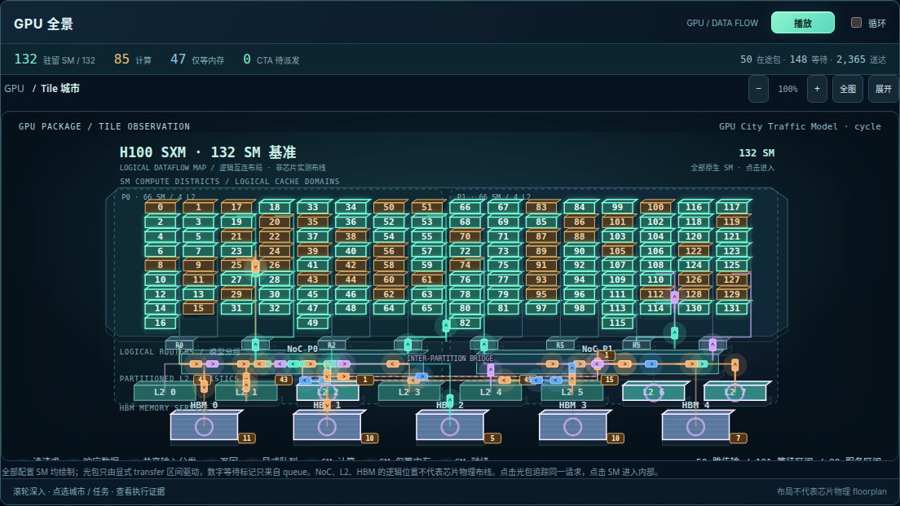
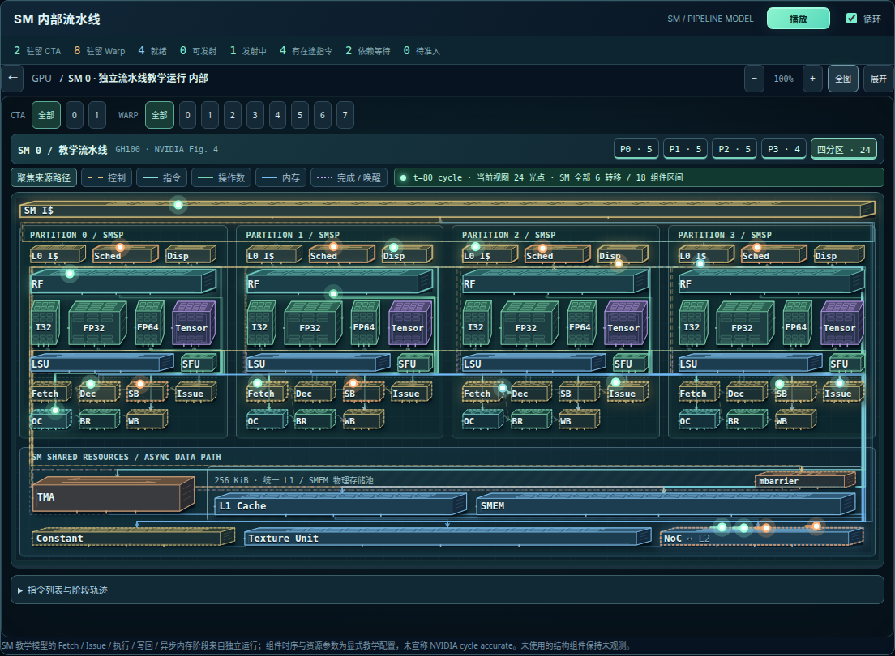
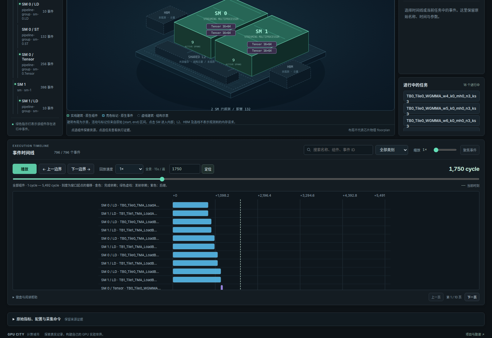
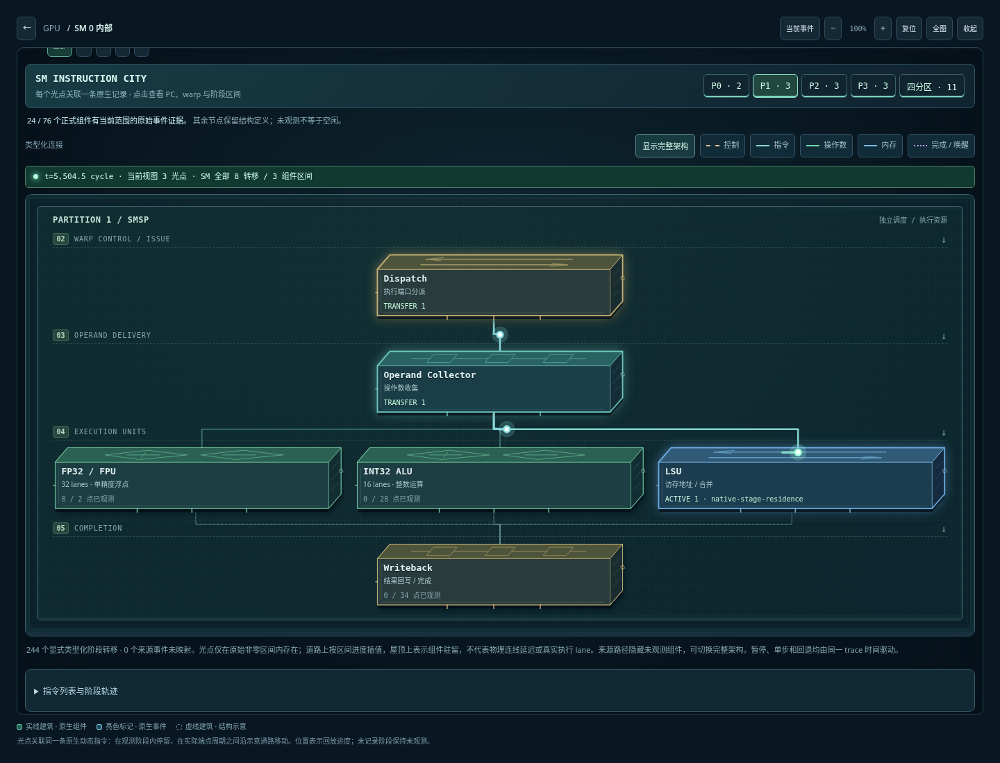

# GPU 计算城市与仿真工作台

目标是一个面向计算机体系结构、AI systems 和 AI infra 用户的开放 GPU 实验世界：既能探索真实 kernel/profile，也能修改 GPU 模型。玩法借鉴模拟城市的建设与交通治理、Minecraft 的自由创作，以及 Factorio 的可见物流。

开发顺序是**先保证模型、事件和交互功能正确，再增加城市渲染和游戏机制**。本仓库目前交付相关工作调研、产品与模型设计，以及一个可运行的事件回放原型。

**[在线工作台](https://liuweibupt.github.io/GPU-sim/)** · [SM 组件形式化规格](docs/sm-architecture.md) · [数据流模型](docs/traffic-model.md) · [发布流程](docs/deployment.md) · [多尺度仿真设计](docs/multiscale-simulation.md)

## 黄Sir的算力工坊

新增独立挂机经营网页：[在线游戏](https://liuweibupt.github.io/GPU-sim/web/game/)；原 [GPU 工作台](https://liuweibupt.github.io/GPU-sim/) 保留，两个页面可相互跳转。运行 `npm start` 后也可打开 [本地游戏](http://127.0.0.1:4173/web/game/)。原创 SVG 黄Sir 带你从 **一颗 ALU、零缓存、零显存** 开始，自动接收浮点计算订单、交付赚钱，再购买新硬件；点击「手动超频」或按空格可加速起步。

成长分两条线：**硬件研发**按经营收入与组件前置逐步开放 ALU、时钟、L1、DRAM、L2、调度器、Tensor Core、HBM、TMA、TMEM；**应用委托**从标量、向量、像素和物理计算开始，后期再挑战 AlexNet、Transformer、大模型训练、长序列推理与架空 AI 工厂。无需完成应用任务也能发展全部硬件；普通订单种类只随硬件扩展。

另有两个模式共用的**系统与软件生态**研发线：PCIe 接入、NVLink 多卡互联、IB 合作采购或收购网络团队、机柜集成，以及 CUDA 工具链、加速库和开发者生态。软件带来订单溢价，机柜与网络改善大型应用交付；创业赛额外计入市场需求和持续维护费用。收购路线以 NVIDIA 于 2020 年收购 Mellanox 为历史灵感，NVLink 则是 NVIDIA 自研技术。[经营选择与技术来源](docs/systems-business.md)

故事通过客户、开发者和工程师的来信推进。答复会改变实际经营，并在后续来信中留下回音；不同承诺与交付结果形成隐藏尾声。游戏只展示当前事件与已经发生的结果，达成尾声后仍可继续经营。旧通关存档也能体验新增往来。[故事设计](docs/narrative-design.md)

工坊使用计算—存储—重叠解析模型：根据运算量、工作集、缓存容量、带宽与延迟隐藏推导处理速度，不再提供实验性的 Tile 资源模式。瓶颈提示与商店升级预览使用同一套周期计算。旧存档的资金、硬件和订单进度保留，原 Tile 模式存档恢复后使用解析模型继续结算。详细边界见 [工坊模型说明](docs/idle-game-design.md#解析性能模型)。

浏览器每 5 秒自动存档，支持导入/导出、离线收益（最多 8 小时）、减少动画和确认重置。订单速度与缓存命中率来自工坊的独立教学模型；关卡、模型参数与价格为游戏设定，不代表实机性能。[完整玩法与剧情策划](docs/idle-game-design.md) · [验证记录](docs/idle-game-validation.md)

## 创业 PvE：与 Lisa 争夺 GPT-3 时刻

[在线创业赛](https://liuweibupt.github.io/GPU-sim/web/game/pve/) 是独立的新页面，保留原工坊和工作台。你、Lisa 与虚构的灰盒实验室从相同的一颗 ALU 起步；对手会持续接单、投资、融资和研发。赛场分别记录第一桶金、GPT-3 模型训练与商业首单的最早到达者，离线时三家公司也按同一时钟经营。

新增模拟股价窗口、一次性 IPO、流通股回购，以及运营成本、透支和破产线。IPO 进入公司现金但不计入营业收入，回购真实减少现金；盲目扩张可能让公司亏损破产。创业赛有独立存档，可以暂停全场或重开。

创业赛与普通工坊统一使用**计算—存储—重叠解析模型**，从指令发射、工作集、缓存容量、带宽、延迟隐藏和 TMA/TMEM 数据路径推导周期与瓶颈，替代部件倍率直接相乘。界面可检查模型输入和周期分解。系统与生态收益在商业层单独计算，不改变单颗 GPU 的解析吞吐。参数尚未用实机标定，未宣称训练了 XGBoost，也未将 PipeWeave 外推到单 ALU。

`npm run benchmark:pve` 可复现主动经营获胜、挂机被对手超过及过度扩张破产的完整策略。[玩法与经济规则](docs/pve-design.md) · [性能模型与本地 PipeWeave 核查](docs/compute-model.md) · [策略结果](docs/pve-balance.json) · [验证记录](docs/pve-validation.md)

## GPU 城市界面

- 默认使用 **H100 SXM 规模的数据流城市**：完整 132 个 SM、5 个 HBM 服务端点，以及逻辑 L2 / NoC。数量依据 [NVIDIA 规格](https://developer.nvidia.com/blog/nvidia-hopper-architecture-in-depth/)，路由、带宽和周期采用本仓库明确标注的教学模型。
- 读请求、HBM 返回、L2 共享分发和写回是可点击的移动数据包；链路和端点排队来自离散事件模型。调 NoC / HBM 带宽、开关共享请求合并后重新仿真，会改变实际完成时间与运输事件。
- NoC 默认采用**双分区 Crossbar / 局部 L2**：SM 访问本分区缓存，远端内存 miss 才过跨分区桥。链路串行化与传播时间分开，传播延迟不会被误当成全程带宽占用。结构约束参考 [NVIDIA 白皮书](https://resources.nvidia.com/en-us-hopper-architecture/nvidia-h100-tensor-c) 与 [Jin 等 MICRO 2024 论文](https://people.ece.ubc.ca/aamodt/publications/papers/realgpu-noc.micro2024.pdf)，具体聚合拓扑与周期仍是未校准的教学模型。
- **2.5D 等距硬件城市**区分 SM 的驻留、计算与访存等待：绿色表示计算，琥珀色表示全部驻留 CTA 在等内存。默认 396 CTA 在起点覆盖全部 132 SM，每 SM 最多驻留 2 CTA，初始还有 132 CTA 待派；资源释放后立即从全局队列补位。
- 点击任意 SM 会启动该编号的**独立流水线教学运行**，并保留 GPU 全景的时间与记录；上方“SM 内部”可恢复详细运行。CTA/warp 是 SM 内的筛选范围。盒子内的光点由模型阶段区间驱动，默认循环回放；暂停、定位和单步都保持原始时钟。
- 当前 GTSim 轨迹支持原生 SM/pipeline 和 CTA/warp 归属联动、进行中与已完成区间计数、tile 数据窗口、任务及依赖检查。未提供独立事件的 L2/HBM/调度器以结构示意呈现。
- 另有可展开的 GTSim 操作语义与任务依赖面板：按 SM / CTA 查看 Load、Tensor、Store 的并行活动和上下游依赖，共享时间轴可定位访存/计算重叠。它保留原操作区间，**不解释为逐跳 NoC 事务**。
- 该语义面板把 tile 搬运表示为移动方包，按 2 / 4 B 每元素估算 KiB，已加载 tile 引用用菱形区分。点击任务可追踪依赖，拥挤通道保留清单；GPU 城市里的网络光包则只使用明确的 `transfer` 记录。
- 只保留一个播放入口与一个当前事件列表；组件树、实验参数和来源说明默认折叠。时间线支持 1–16× 局部放大、聚焦事件、精确 cycle/us 定位。桌面默认四分区，手机默认 P0 并允许画布内滚动，避免缩成不可读的小图。
- 数据流模型、原 GTSim GEMM 与低 L2 带宽对照可直接切换，工作区同时保存选择、任务范围、架构尺度与时间窗口。Profile 导入保留原生轨道。

立体沙盘由本仓库原生 SVG/CSS 绘制，不依赖 WebGL 或外部渲染服务。建筑高度、位置与连线几何不代表实测面积、容量或物理 floorplan；运输只沿当前运行声明的拓扑与 hop 区间移动。旧 GTSim/profile 缺少内部运输事件时不生成车流，配置 SM 占位明确标为未观测。此前生成的六类透明组件美术保留在仓库，提示词见 [manifest.json](web/assets/gpu/manifest.json)。

仿真在浏览器的 **Web Worker** 中运行，重新仿真和切换场景会终止过期计算。播放时的事件查询使用 **WebAssembly 区间树**，无法加载 WASM 时使用同算法的 JavaScript 索引。动画按 30 Hz 更新、检查面板按 10 Hz 更新；时钟按实际经过时间推进，暂停、定位和原始事件周期保持一致。[优化方法与浏览器实测](docs/browser-performance.md)



[本次界面与模型验证](docs/sm-residency-validation.md)

[模型规则与边界](docs/noc-model.md) · [旧单 Fabric 的请求追踪截图](docs/assets/traffic-request.png)

[上一版盒子城市](docs/assets/workbench.png) · [上一版 SM 流水线](docs/assets/box-sm.png)

## SM 并发、访存等待与共享读取

真实 CUDA 会把 grid 中的 CTA 派到有资源的 SM，**不保证所有 SM 在同一周期启动，也不保证所有驻留 SM 同时发射或计算**。足够大的规则 grid 通常可覆盖多数 SM；小 grid、寄存器/SMEM 资源限制、依赖、访存和尾部都会降低瞬时并行。旧界面只点亮 compute 区间，将访存等待误显为空闲；旧 HBM 模型还把固定延迟串行占满端点，过度压低计算并发。现已分开显示驻留/计算/等待，HBM 固定延迟允许与后续请求重叠，数据仍按实际完成才可消费。spread-first、周期和资源计数是本仓库教学策略，并非 NVIDIA 调度器复现。[CUDA 编程模型](https://docs.nvidia.com/cuda/cuda-programming-guide/01-introduction/programming-model.html#thread-blocks-and-grids) · [Hopper 资源约束](https://docs.nvidia.com/cuda/hopper-tuning-guide/index.html#occupancy)

### 并发共享读取与广播的区别

多个 SM 可以并发请求重叠输入，L2 缓存重用和 pending miss 合并可能减少 HBM 流量，数据仍按各请求单播返回。H100 的局部分区可以分别填充同一数据；默认模型不再保证全 GPU 共用一次填充。合成场景使用整 Tile 合并策略，尚未实现实际 sector/MSHR，也未复现实测 SM↔L2 延迟矩阵。[完整 NoC 模型](docs/noc-model.md) · [论文核查](docs/research/gpu-noc.md)

真正的 Hopper TMA multicast 是软件显式发起、限定同一 thread-block cluster 内 CTA mask 的 global→SMEM 搬运，不能自动扩展成 132 SM 广播。当前城市模型执行普通读取，SM 教学模型执行单目标 TMA；它们都未执行 cluster multicast。L2 复用、TMA multicast、DSM 和跨 GPU NVLink 是不同机制。

## SM 内部：组件规格与流水线仿真

进入任意已记录的 SM 后，可查看四个分区及共享存储区；选择单个分区进一步阅读。图、事件和说明使用同一份 [机器可读规格](lib/sm-architecture.js)，每个组件定义作用、作用域、输入/输出类型、状态、资源、时序、转换条件、释放条件、不变量与来源等级。[完整形式化说明](docs/sm-architecture.md)

SM 内部采用参考 [NVIDIA Hopper 官方 SM 图（Figure 4）](https://developer.nvidia.com/blog/nvidia-hopper-architecture-in-depth/) 的 **2.5D 功能结构图**：控制通路是窄条，RF 是宽存储带，FP32/INT32/FP64 是不同规模的执行阵列，Tensor 是较大的矩阵块，四分区下方共用宽的 L1/SMEM 存储池。逻辑追踪阶段保留较小的示意节点，TMA、同步对象和 NoC 边界也使用不同形态。画布按屏幕宽高自动适配，移动光点可暂停、定位和点击追踪；完整组件名称及规则可悬停或点击查看。尺寸表示功能层次，不表示晶片物理面积、延迟或吞吐比例；格纹与接脚数量不表示实测阵列、bank或端口数。[布局依据与边界](docs/sm-architecture.md#功能布局与视觉比例)

- **取指与发射：** L1/L0 指令缓存、Fetch、Decode、Warp Scheduler、Scoreboard、Issue、Dispatch。
- **操作数与执行：** Register File、Operand Collector、FP32 FPU、FP64 FPU、INT32、SFU、Tensor Core、LSU、Branch/Reconvergence、Writeback。
- **存储与异步通路：** L1 Data/Texture Cache、Shared Memory、TMA、mbarrier、Texture、Constant Cache、NoC/L2 边界。L1/SMEM 共用物理容量预算，但寻址和同步语义不同；TMA 的大块数据无需经过 RF。

点击 GPU 中的 SM，或展开 **“SM 流水线实验”**重新运行，在所选 SM 上生成独立的教学运行：显式取指/译码/发射/执行/写回，RAW/WAW 与资源等待、普通 load 命中/缺失、SMEM bank 冲突，以及异步 TMA→SMEM→mbarrier→Tensor 消费。可修改总 warp 数（最多 128）、每 CTA warp、每线程寄存器、驻留 warp 上限、Issue 间隔、外部内存与 Tensor 延迟、SMEM 地址步长后重跑；原始事件时间不会随动画速度改变。点选组件查看形式化规则，点选事件查看具体指令、寄存器、等待原因与依赖。

新增整 CTA 的 FIFO 资源准入与退场：同时受驻留 warp/CTA、四分区寄存器和 SMEM carveout 约束，排队 CTA 在资源释放后复用存储空间。瞬时状态区分 resident、ready、eligible、issuing、inflight 与依赖等待；这些指标有包含或重叠关系，不能相加当作利用率。

这是自行实现的**符号时序教学模型**，不执行张量数值或任意 PTX/SASS，不声称 NVIDIA cycle accuracy。公开结构与容量引用 NVIDIA Hopper/CUDA 资料；Fetch/Decode 等逻辑阶段、队列及周期参数是教学定义。指令缓存与分支只做时序服务，不执行 cache tag/miss 或真实分支掩码；纹理和常量路径只保留结构。有限资源在途容量与上游 credit 已建模，逐组件有限队列及全链路背压仍未实现。旧 GTSim/profile 缺少 SM 内部事件时，只显示结构，不补造流水线活动。

```bash
node scripts/generate-sm.mjs
```

生成的 [SM 教学样例](examples/h100-sm.json) 可导入、导出，或与城市运行共同保存在工作区；两者的时钟与指令/Tile ID 不自动对应。



[查看 TMA 形式化规格与本次运行参数](docs/assets/sm-tma-spec.png)

## 两级仿真与指令视图

**GPU 全景观察 Tile 与数据运输，SM 内部检查任务或载入指令运行**。CTA/warp 是 SM 内的筛选条件，不再是第三张场景。详细运行与宏观运行分别保存。

- 外层默认在浏览器运行双分区数据流教学模型，132 SM 共完成396个 Tile；可调整桥传播延迟、链路带宽与共享 Tile 策略后重跑。单 Fabric 可作对照。GTSim timing graph 继续作为独立外部后端样例，仍为796区间、5,492 / 6,413 cycles。
- 内层默认生成所选 SM 的教学运行；从**实验场景**明确选择 FlashGPU-Sim 后，才会载入独立的实际 [指令生命周期样例](examples/flashgpu-vectoradd-pipeline.json)，其记录仅覆盖 2 个 SM，不代表 132 SM 全景负载：在每个已记录 SM 内，光点沿 Dispatch → Operand Collector → 原生执行单元 → Writeback 的示意通路推进，并在实际阶段区间中停留。可切换 SM / 四分区、点击光点检查 PC / warp / 动态指令 ID 与全部原生阶段，暂停、慢放和回退。
- 新增只读 observer 补丁记录 176 条动态指令的 1,136 个实际阶段点，生成 488 个移动区间与 190 个驻留区间；2 个有记录的 SM、8 个 warp 都有原生光点。默认聚焦来源路径，完整架构仍可展开。回放循环限定在原生指令实际观测窗口内，原始周期编号保持不变。组件按控制、存储、执行和同步职责使用不同尺寸，并按当前屏幕宽高自动适配；可在一屏内观察组件与光点，画布顶部直接播放/暂停。组件使用简写，完整名称及规则可悬停或点击查看。光点位置按实际端点周期插值，几何是可视化布局。原 ISSUE/STALL [点日志样例](examples/flashgpu-vectoradd.json) 保留为独立场景。
- **工作区与导出 → “导入指令运行”** 接受 [FlashGPU-Sim 原生 pipeline observer / ISSUE/STALL 日志](tools/detailed/README.md) 或详细 observer JSON。指令面板显示当前或最近已观测周期，轨道随回放位置更新并保留所选事件。观测点与执行区间分别计数，不从点日志生成完成时间；教学流水线仍可单独运行。
- 两份运行分别保存回放位置、速度、选择和镜头；工作区 v2 一起保存，仍可打开 v1。数据流全景默认90秒/遍，SM检查120秒/遍；GTSim保持15 / 30秒，指令窗口慢放60秒。详细运行默认勾选循环，工作区保留循环选择；减少动画模式默认暂停。这与后端仿真耗时无关。

**Accel-Sim 2.0 尚未接入可执行的输出 observer。** 其输入 `.tracez` / `.traceg` 不含所需的仿真完成时间，不能直接当作执行轨迹。FlashGPU-Sim 已按固定 commit 在本机编译并运行，小型 vectorAdd 经 CPU 参考结果校验后导出原生日志与指令 JSON；[流水线运行清单](examples/flashgpu-vectoradd-pipeline.manifest.json) 保留源码/config/log hash、采集范围与实测墙钟耗时。两种后端各自保留时钟，未把独立运行的 cycle 融合成同一次运行。[接入格式与命令](tools/detailed/README.md) · [多尺度边界](docs/multiscale-simulation.md)



[两级回放验证](docs/two-level-validation.md) · [原生指令接入验证](docs/instruction-validation.md) · [SM 光点验证](docs/sm-light-validation.md)



## 运行功能原型

需要 Node.js 18+，无 npm 依赖，也不需要物理 GPU。

```bash
npm test
npm run validate
npm start
```

打开 [本地工作台](http://127.0.0.1:4173/web/)。默认数据流场景在浏览器运行，无物理GPU要求；提供播放、暂停、事件边界单步、时间定位、组件/包/任务联动、依赖检查与本地存档。共享输入在L2合并后逐目标分发，不宣称HBM原生广播；队列无界，尚无有限buffer / credit背压或真实H100时序校准。[模型、协议与可复现实验](docs/traffic-model.md)

GTSim 样例是**仿真轨迹**，不是实机 profile。GTSim 在这里执行 timing graph，不计算 GEMM 张量数值；通过其回归和回放测试不代表已证明数值正确，也不代表预测周期等于真实 H100。Profile 导入只显示原有轨道与区间，不补造 SM 调度或 cache/NoC 事务。所有导入和存档保留在浏览器或用户下载文件中，无上传服务。

重新生成 GTSim 数据、支持的参数与校验方法见 [GTSim adapter](tools/gtsim/README.md)。

可导入 [低 L2 带宽的第二次仿真](examples/gtsim-gemm-slow-l2.json) 对照观察：同一 workload 为 6,413 cycles。当前支持分别回放，尚未实现并排 A/B 面板。

## 调研与设计

基础工具调研与来源核查日期：2026-10-14；HCI 投稿与指标方案更新至 2026-10-18。项目状态按官方仓库、原作者论文和文档区分，论文结果不等于公开版能力。

| 文档 | 内容 |
| --- | --- |
| [第一版设计](docs/design.md) | 用户目标、计算城市玩法、阶段划分、架构和验收标准 |
| [模型与数据契约](docs/model-and-data-contract.md) | 原型 trace、时间与依赖语义、未来有限队列模型和可扩展接口 |
| [H100规模数据流模型](docs/traffic-model.md) | 132SM / 5HBM、请求/响应、L2共享合并、逐跳NoC排队、带宽实验与模型边界 |
| [SM 组件形式化规格](docs/sm-architecture.md) | 四分区、取指/发射/执行/存储组件、typed ports、状态转换与流水线教学模型边界 |
| [分区 NoC 模型](docs/noc-model.md) | 局部 L2、远端 HBM miss、跨分区桥、串行化/传播、带宽预算与未实现机制 |
| [真实 GPU NoC 论文核查](docs/research/gpu-noc.md) | MICRO 2024 与 H100 白皮书、一手证据与推断、普通读取/TMA multicast/DSM 的区别 |
| [多尺度仿真](docs/multiscale-simulation.md) | SM 城市、tile / 指令 / 请求粒度，以及 GTSim 与详细后端的关联设计 |
| [网站发布](docs/deployment.md) | GitHub Pages 构建、首次启用与部署验证 |
| [验证记录](docs/validation.md) | 自动检查、原生参数实验、浏览器交互与存档规模验证 |
| [GPU 仿真器调研](docs/research/simulators.md) | Accel-Sim 2.0、GTSim、FlashGPU-Sim，以及 GPGPU-Sim、MGPUSim、Multi2Sim |
| [可视化与 profiler 调研](docs/research/visualization.md) | Daisen、AerialVision、GPUVision、Nsight、RGP、Perfetto 等 |
| [游戏与交互调研](docs/research/games.md) | 城市建造、Minecraft、Factorio、Zachtronics、GPU 教学项目的可移植机制 |
| [HCI 投稿与指标方案](docs/research/hci-publication-plan.md) | CHI/CSCW/VIS 定位、10 篇学术近邻、唯一主要终点、对照实验、样本规划与后续优化 |
| [Gem5SimCity 参考核查](docs/research/gem5-simcity.md) | 用户指定示例的真实仿真接入、源码交互、表现性简化与正确性边界 |

## 当前能力与后续开发

当前具备可重仿真的简化数据流模型、独立 SM 流水线教学模型，以及“外部仿真器 → 可追溯事件 → 可检查回放”链路。它们分别保留运行来源和时钟。立体城市是2.5D交互渲染；尚无自由旋转3D世界、任意CUDA/Triton执行、自由拼装硬件或多人服务。

已接入 FlashGPU-Sim 的原生指令阶段、完成与 SM 光点回放；下一步增加存储请求关联，让宏观 tile 任务与微观 transaction 可以关联探索。首先采用同一 workload 的独立 run 与受控比较，再研究 checkpoint / 局部精化；不任意抽出一个 CTA 热切模拟器。详细仿真允许耗时，后台运行、GPU 时间和动画速度分别管理。并行完善有限队列、带宽、调度与背压的可编辑模型，以及世界建设、预算与可选挑战。

## 致谢与项目来源

感谢以下项目的作者、维护者与贡献者提供公开代码、数据格式、研究成果和交互设计。这里按本项目的实际使用方式列明贡献。

| 项目与贡献者 | 本项目的使用方式 |
| --- | --- |
| [NVIDIA Hopper 架构资料](https://developer.nvidia.com/blog/nvidia-hopper-architecture-in-depth/)，Michael Andersch 等作者，以及 [Hopper Tuning Guide](https://docs.nvidia.com/cuda/archive/13.0.3/hopper-tuning-guide/index.html)、[PTX ISA](https://docs.nvidia.com/cuda/archive/12.8.1/parallel-thread-execution/index.html) 的 NVIDIA 团队 | **硬件规格与 ISA 语义来源。** H100 SXM 的132SM/5HBM、SM四分区与执行单元数量、RF与L1/SMEM容量、TMA及mbarrier语义依据这些资料。本仓库自行实现符号时序教学模型与SVG图，不复制官方图稿，不声称NVIDIA官方仿真器、物理netlist或真实NoC复原。 |
| [Uncovering Real GPU NoC Characteristics](https://people.ece.ubc.ca/aamodt/publications/papers/realgpu-noc.micro2024.pdf)，Zhixian Jin、Christopher Rocca、Jiho Kim、Hans Kasan、Minsoo Rhu、Ali Bakhoda、Tor M. Aamodt、John Kim；以及 NVIDIA [H100 白皮书](https://resources.nvidia.com/en-us-hopper-architecture/nvidia-h100-tensor-c) | **NoC 方法与公开结构来源。** 依据分区局部性、往返延迟/吞吐区别与带宽层级修正模型；未复制论文代码/图表，也未声称已复现实测矩阵。用户提供的知乎解读引导了论文核查，一手证据和推断区别见 [NoC 调研](docs/research/gpu-noc.md)。 |
| [GTSim / GPU-Tile-Sim](https://github.com/SJTU-ReArch-Group/GTSim)，Yitong Ding、Jiawei Huang 等作者与 SJTU-ReArch-Group 贡献者 | **已接入的外部时序后端。** Adapter 下载并编译固定版本的原始 core 与 GEMM builder，读取原生节点时间；两个GTSim样例均由它生成。MIT 版权声明属于 Jiawei Huang，完整保留于 [第三方声明](THIRD_PARTY_NOTICES.md)，版本与 archive hash 见 [锁定清单](tools/gtsim/upstream.json)。 |
| [Gem5SimCity](https://github.com/Entropy-xcy/Gem5SimCity)，Entropy-xcy 与项目贡献者 | **形态与交互的直接参考。** 借鉴真实 simulator→trace→交互回放的分层及计算机结构城市化、组件建筑与可见数据通路的表达。本项目的外层 SM 城市及内部组件盒子采用自行实现的 SVG；viewer 和 observer 自行实现，未复制其源码、trace 或美术资产。核查版本与对应设计见 [参考分析](docs/research/gem5-simcity.md)。 |
| [Daisen / Akita](https://github.com/sarchlab/akita/tree/main/daisen)，Yifan Sun、Yixuan Zhang、Ali Mosallaei、Michael D. Shah、Cody Dunne、David Kaeli 及项目贡献者 | **GPU 可视化研究与交互参考。** 借鉴任务、组件、时间与依赖联动的思路；当前未集成其代码。 |
| [FlashGPU-Sim](https://github.com/FlashGPU-Sim/FlashGPU-Sim) 的作者与贡献者 | **已接入的外部指令后端。** 固定版本编译并运行 vectorAdd，读取 ISSUE/STALL 和只读 observer 的动态指令阶段日志；代码与运行器见 [adapter](tools/detailed/README.md)。不从点记录推断执行完成或存储路径。 |
| [Accel-Sim](https://accel-sim.github.io/)、[GPGPU-Sim / AerialVision](https://github.com/gpgpu-sim/gpgpu-sim_distribution)、[MGPUSim](https://github.com/sarchlab/mgpusim)、[Multi2Sim](https://github.com/Multi2Sim/multi2sim) 的作者与贡献者 | **相关工作与后续 adapter 研究。** 已比较模型、数据粒度、版本和公开能力；这些工具尚不是本原型已接入的执行后端。 |
| [Perfetto](https://perfetto.dev/docs/getting-started/other-formats)、[PyTorch / Kineto](https://github.com/pytorch/kineto)、[NVIDIA Nsight](https://developer.nvidia.com/tools-overview)、[AMD RGP](https://gpuopen.com/rgp/) 的作者与贡献者 | **数据格式与性能工具参考。** 当前自行实现 Chrome/PyTorch duration JSON importer；Nsight、RGP 的原生报告尚未直接接入。 |
| [Minecraft](https://www.minecraft.net/) 的 Mojang Studios、[Factorio](https://www.factorio.com/) 的 Wube Software、[Cities: Skylines II](https://www.paradoxinteractive.com/games/cities-skylines-ii/about) 的 Colossal Order / Paradox Interactive、[Zachtronics](https://www.zachtronics.com/)、[Tomorrow Corporation](https://tomorrowcorporation.com/)，以及 [GPU Puzzles](https://github.com/srush/GPU-Puzzles) 的 Sasha Rush 与贡献者 | **开放创作、可见物流、城市经营与工程教学的玩法参考。** 对应官方来源与机制分析见 [游戏调研](docs/research/games.md)，当前未使用其代码或游戏资产。 |

项目引用不表示原作者参与或认可本项目。代码的再分发声明与学术引用分别保留：实际依赖见 [THIRD_PARTY_NOTICES.md](THIRD_PARTY_NOTICES.md)，完整文献与原始来源见 [参考文献](docs/references.md) 和 [BibTeX](docs/references.bib)。后续接入新后端或复用代码、数据与素材时，同步更新该表和对应第三方声明。

## 主要论文引用

以下论文支撑当前后端选择与相关工作分析；本项目的参数实验不能替代原论文实验。

1. Yitong Ding et al. **GPU-Tile-Sim: A Tile-Centric GPU Simulation Framework for LLM Hardware-Software Co-Design.** 2026，arXiv:2607.11262；作者注明 accepted to MICRO 2026。[论文](https://arxiv.org/abs/2607.11262)
2. Yifan Sun et al. **Daisen: A Framework for Visualizing Detailed GPU Execution.** 2021，EuroVis / Computer Graphics Forum。[作者预印本](https://arxiv.org/abs/2104.00828)
3. Mahmoud Khairy et al. **Accel-Sim: An Extensible Simulation Framework for Validated GPU Modeling.** ISCA 2020。[项目与论文入口](https://accel-sim.github.io/)
4. Junrui Pan et al. **Architecting the Next Generation of Asynchronous, Distributed GPUs for the AI Era.** 2026，arXiv:2608.22602，Accel-Sim 2.0 相关预印本。[论文](https://arxiv.org/abs/2608.22602)
5. Siying Yu et al. **FlashGPU-sim: Enabling GPU Modeling for Modern Architectures and AI Workloads.** 2026，arXiv:2609.15311；作者注明 to appear in MICRO 2026。[论文](https://arxiv.org/abs/2609.15311)
6. Zhixian Jin et al. **Uncovering Real GPU NoC Characteristics: Implications on Interconnect Architecture.** MICRO 2024, pp. 885–898, DOI: 10.1109/MICRO61859.2024.00070。[作者论文](https://people.ece.ubc.ca/aamodt/publications/papers/realgpu-noc.micro2024.pdf)

GPGPU-Sim、AerialVision、MGPUSim 与 gem5 等基础工作的作者、出版信息及可复用引用条目一并列在 [完整参考文献](docs/references.md)。研究文档还在具体事实附近保留了版本、格式、游戏与教学项目的一手来源链接。
