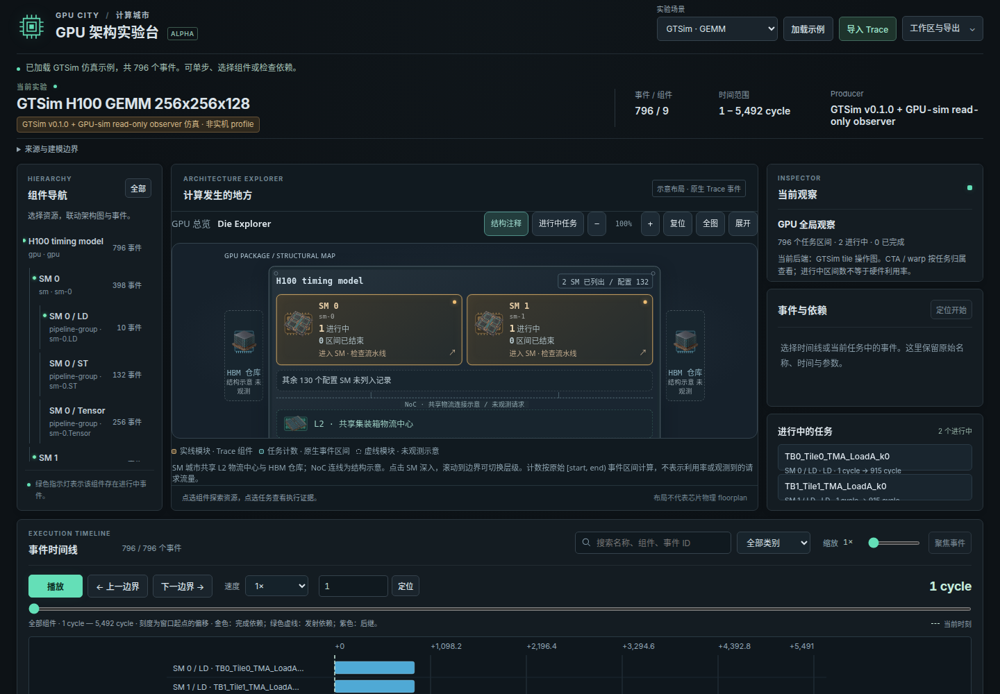

# GPU 计算城市与仿真工作台

目标是一个面向计算机体系结构、AI systems 和 AI infra 用户的开放 GPU 实验世界：既能探索真实 kernel/profile，也能修改 GPU 模型。玩法借鉴模拟城市的建设与交通治理、Minecraft 的自由创作，以及 Factorio 的可见物流。

开发顺序是**先保证模型、事件和交互功能正确，再增加城市渲染和游戏机制**。本仓库目前交付相关工作调研、产品与模型设计，以及一个可运行的事件回放原型。

**[在线工作台](https://liuweibupt.github.io/GPU-sim/)** · [发布流程](docs/deployment.md) · [多尺度仿真设计](docs/multiscale-simulation.md)

## GPU 城市界面

- 每个 SM 是一座可进入的计算城市，L2 是共享物流中心，HBM 是区域仓库；GPU → SM → CTA → warp 逐级观察，滚轮向下深入、向上返回，也可使用按钮。
- 当前 GTSim 轨迹支持原生 SM/pipeline 和 CTA/warp 归属联动、进行中与已完成区间计数、tile 数据窗口、任务及依赖检查。未提供独立事件的 L2/HBM/调度器以结构示意呈现。
- 时间线支持 1–16× 局部放大、聚焦所选事件、点击定位和精确 cycle/us 输入。深入观察时动画默认放慢；原始仿真时间保持不变。
- 默认 GEMM 与低 L2 带宽对照可直接切换，工作区同时保存选择、任务范围、架构尺度与时间窗口。Profile 导入保留原生轨道。

SM、Tensor、scheduler、cache、HBM、warp 六类透明组件美术由内置 `image_gen` 工具生成，保存在 [web/assets/gpu](web/assets/gpu/README.md)，完整提示词见 [manifest.json](web/assets/gpu/manifest.json)。交互标签与实际任务状态由前端单独绘制；美术中的格子与灯光不编码实测数量或状态。



## 运行功能原型

需要 Node.js 18+，无 npm 依赖，也不需要物理 GPU。

```bash
npm test
npm run validate
npm start
```

打开 [本地工作台](http://127.0.0.1:4173/web/)。默认数据来自固定版本 GTSim 的完整小 GEMM timing graph 仿真：796 个区间、5,492 cycles，配置固定 132 SM，界面只列本次有任务的 SM/pipeline。支持播放、暂停、按事件边界单步、时间定位、组件与任务联动、依赖检查及本地存档。也可导入统一 trace 或 Chrome/PyTorch profiler 的 JSON duration trace。

GTSim 样例是**仿真轨迹**，不是实机 profile。GTSim 在这里执行 timing graph，不计算 GEMM 张量数值；通过其回归和回放测试不代表已证明数值正确，也不代表预测周期等于真实 H100。Profile 导入只显示原有轨道与区间，不补造 SM 调度或 cache/NoC 事务。所有导入和存档保留在浏览器或用户下载文件中，无上传服务。

重新生成 GTSim 数据、支持的参数与校验方法见 [GTSim adapter](tools/gtsim/README.md)。

可导入 [低 L2 带宽的第二次仿真](examples/gtsim-gemm-slow-l2.json) 对照观察：同一 workload 为 6,413 cycles。当前支持分别回放，尚未实现并排 A/B 面板。

## 调研与设计

调研与来源核查日期：2026-10-14。项目状态按官方仓库、原作者论文和文档区分，论文结果不等于公开版能力。

| 文档 | 内容 |
| --- | --- |
| [第一版设计](docs/design.md) | 用户目标、计算城市玩法、阶段划分、架构和验收标准 |
| [模型与数据契约](docs/model-and-data-contract.md) | 原型 trace、时间与依赖语义、未来有限队列模型和可扩展接口 |
| [多尺度仿真](docs/multiscale-simulation.md) | SM 城市、tile / 指令 / 请求粒度，以及 GTSim 与详细后端的关联设计 |
| [网站发布](docs/deployment.md) | GitHub Pages 构建、首次启用与部署验证 |
| [验证记录](docs/validation.md) | 自动检查、原生参数实验、浏览器交互与存档规模验证 |
| [GPU 仿真器调研](docs/research/simulators.md) | Accel-Sim 2.0、GTSim、FlashGPU-Sim，以及 GPGPU-Sim、MGPUSim、Multi2Sim |
| [可视化与 profiler 调研](docs/research/visualization.md) | Daisen、AerialVision、GPUVision、Nsight、RGP、Perfetto 等 |
| [游戏与交互调研](docs/research/games.md) | 城市建造、Minecraft、Factorio、Zachtronics、GPU 教学项目的可移植机制 |
| [Gem5SimCity 参考核查](docs/research/gem5-simcity.md) | 用户指定示例的真实仿真接入、源码交互、表现性简化与正确性边界 |

## 当前能力与后续开发

当前原型验证“外部仿真器 → 可追溯事件 → 可检查回放”这条链路，保留真实时间和依赖语义。它还没有任意 CUDA/Triton 执行、可自由拼装硬件的在线模拟、多人世界或 3D 城市。

下一步接入详细后端的指令与存储请求事件，让宏观 tile 任务与微观 transaction 可以关联探索。首先采用同一 workload 的独立 run 与受控比较，再研究 checkpoint / 局部精化；不任意抽出一个 CTA 热切模拟器。详细仿真允许耗时，后台运行、GPU 时间和动画速度分别管理。并行完善有限队列、带宽、调度与背压的可编辑模型，以及世界建设、预算与可选挑战。

## 致谢与项目来源

感谢以下项目的作者、维护者与贡献者提供公开代码、数据格式、研究成果和交互设计。这里按本项目的实际使用方式列明贡献。

| 项目与贡献者 | 本项目的使用方式 |
| --- | --- |
| [GTSim / GPU-Tile-Sim](https://github.com/SJTU-ReArch-Group/GTSim)，Yitong Ding、Jiawei Huang 等作者与 SJTU-ReArch-Group 贡献者 | **当前实际时序后端。** Adapter 下载并编译固定版本的原始 core 与 GEMM builder，读取原生节点时间；两个提交样例均由它生成。MIT 版权声明属于 Jiawei Huang，完整保留于 [第三方声明](THIRD_PARTY_NOTICES.md)，版本与 archive hash 见 [锁定清单](tools/gtsim/upstream.json)。 |
| [Gem5SimCity](https://github.com/Entropy-xcy/Gem5SimCity)，Entropy-xcy 与项目贡献者 | **第一阶段形态的直接参考。** 借鉴真实 simulator→trace→交互回放的分层及计算机结构城市化表达；本仓库的 viewer 和 observer 自行实现，未复制其源码、trace 或美术资产。核查版本与对应设计见 [参考分析](docs/research/gem5-simcity.md)。 |
| [Daisen / Akita](https://github.com/sarchlab/akita/tree/main/daisen)，Yifan Sun、Yixuan Zhang、Ali Mosallaei、Michael D. Shah、Cody Dunne、David Kaeli 及项目贡献者 | **GPU 可视化研究与交互参考。** 借鉴任务、组件、时间与依赖联动的思路；当前未集成其代码。 |
| [Accel-Sim](https://accel-sim.github.io/)、[GPGPU-Sim / AerialVision](https://github.com/gpgpu-sim/gpgpu-sim_distribution)、[FlashGPU-Sim](https://github.com/FlashGPU-Sim/FlashGPU-Sim)、[MGPUSim](https://github.com/sarchlab/mgpusim)、[Multi2Sim](https://github.com/Multi2Sim/multi2sim) 的作者与贡献者 | **相关工作与后续 adapter 研究。** 已比较模型、数据粒度、版本和公开能力；这些工具尚不是本原型已接入的执行后端。 |
| [Perfetto](https://perfetto.dev/docs/getting-started/other-formats)、[PyTorch / Kineto](https://github.com/pytorch/kineto)、[NVIDIA Nsight](https://developer.nvidia.com/tools-overview)、[AMD RGP](https://gpuopen.com/rgp/) 的作者与贡献者 | **数据格式与性能工具参考。** 当前自行实现 Chrome/PyTorch duration JSON importer；Nsight、RGP 的原生报告尚未直接接入。 |
| [Minecraft](https://www.minecraft.net/) 的 Mojang Studios、[Factorio](https://www.factorio.com/) 的 Wube Software、[Cities: Skylines II](https://www.paradoxinteractive.com/games/cities-skylines-ii/about) 的 Colossal Order / Paradox Interactive、[Zachtronics](https://www.zachtronics.com/)、[Tomorrow Corporation](https://tomorrowcorporation.com/)，以及 [GPU Puzzles](https://github.com/srush/GPU-Puzzles) 的 Sasha Rush 与贡献者 | **开放创作、可见物流、城市经营与工程教学的玩法参考。** 对应官方来源与机制分析见 [游戏调研](docs/research/games.md)，当前未使用其代码或游戏资产。 |

项目引用不表示原作者参与或认可本项目。代码的再分发声明与学术引用分别保留：实际依赖见 [THIRD_PARTY_NOTICES.md](THIRD_PARTY_NOTICES.md)，完整文献与原始来源见 [参考文献](docs/references.md) 和 [BibTeX](docs/references.bib)。后续接入新后端或复用代码、数据与素材时，同步更新该表和对应第三方声明。

## 主要论文引用

以下论文支撑当前后端选择与相关工作分析；本项目的参数实验不能替代原论文实验。

1. Yitong Ding et al. **GPU-Tile-Sim: A Tile-Centric GPU Simulation Framework for LLM Hardware-Software Co-Design.** 2026，arXiv:2607.11262；作者注明 accepted to MICRO 2026。[论文](https://arxiv.org/abs/2607.11262)
2. Yifan Sun et al. **Daisen: A Framework for Visualizing Detailed GPU Execution.** 2021，EuroVis / Computer Graphics Forum。[作者预印本](https://arxiv.org/abs/2104.00828)
3. Mahmoud Khairy et al. **Accel-Sim: An Extensible Simulation Framework for Validated GPU Modeling.** ISCA 2020。[项目与论文入口](https://accel-sim.github.io/)
4. Junrui Pan et al. **Architecting the Next Generation of Asynchronous, Distributed GPUs for the AI Era.** 2026，arXiv:2608.22602，Accel-Sim 2.0 相关预印本。[论文](https://arxiv.org/abs/2608.22602)
5. Siying Yu et al. **FlashGPU-sim: Enabling GPU Modeling for Modern Architectures and AI Workloads.** 2026，arXiv:2609.15311；作者注明 to appear in MICRO 2026。[论文](https://arxiv.org/abs/2609.15311)

GPGPU-Sim、AerialVision、MGPUSim 与 gem5 等基础工作的作者、出版信息及可复用引用条目一并列在 [完整参考文献](docs/references.md)。研究文档还在具体事实附近保留了版本、格式、游戏与教学项目的一手来源链接。
