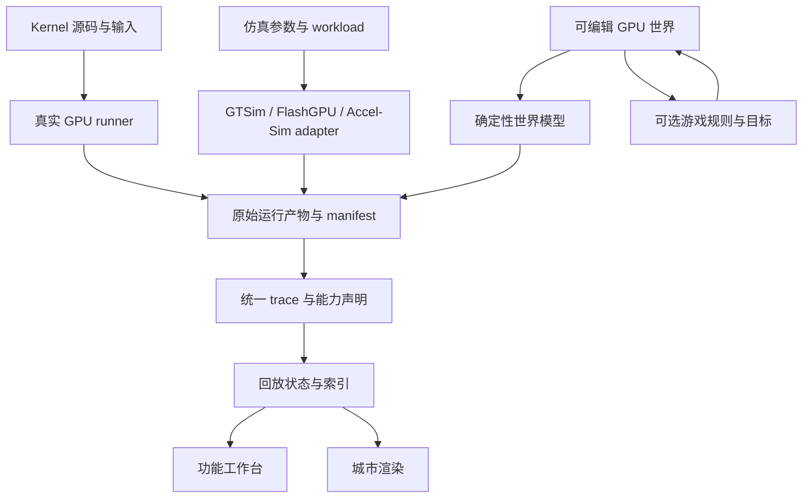

# GPU 计算城市的产品与开发设计

状态：第一版设计与功能原型。日期：2026-10-14。

## 已确定的产品方向

用户首先是体系结构研究与开发、AI systems、AI infra 从业者，后续再扩展新手。首要入口是自由探索真实 kernel/profile，同时能改造 GPU 模型；开放性借鉴 Minecraft，玩法借鉴模拟城市与交通治理。实验和建造由玩家自定目标，关卡作为可选引导。

第一阶段参考 [Gem5SimCity 原作者项目](https://github.com/Entropy-xcy/Gem5SimCity) 的“真实仿真器 → trace → 浏览器回放”形态，先做正确、可检查的功能工作台。后续城市外观、动画和游戏系统都读取同一份状态与事件，不另造一套视觉逻辑。参考源码核查见 [Gem5SimCity 调研](research/gem5-simcity.md)；本次无法加载线上部署，不能确认部署与仓库版本一致。

产品价值是让用户回答：**数据现在在哪里，什么任务在等什么，哪一项改动会怎样改变执行？** 自由度来自可组合的构件、开放 workload、可保存实验和可扩展模型。

## 城市与 GPU 如何对应

| 城市隐喻 | 对应机制 | 玩家可以做的事 | 类比边界 |
| --- | --- | --- | --- |
| 加工区与工厂 | SM、执行 pipeline | 增加模型执行资源、修改 workload 分工 | SM 不能像任意独立 CPU 一样随意执行 CUDA block |
| 仓储与配送中心 | HBM、L2、L1 | 改容量、带宽、缓存策略 | shared memory 是显式管理的工作区，不能画成必经自动 cache |
| 工厂内部工作台 | shared memory、register footprint | 改 tiling、padding、数据复用 | 寄存器由编译器和架构共同约束；不能免费无限增加 |
| 道路与运输 | NoC、访存请求/响应、数据 tile | 改互连容量、观察排队与背压 | 只有后端提供路径，才能画成该次执行的确定路线 |
| 任务调度站 | CTA/warp 调度器 | 改模型策略、查看资源阻塞 | warp 是受 SIMT 约束的执行集合，不是一辆自由寻路的车 |
| 材料到齐再开工 | 数据依赖与 barrier | 定位等待来源、调整 pipeline | 数据依赖、发射次序、内存同步具有不同语义 |
| 城市交通负荷 | kernel/workload 与输入 shape | 放置、运行、复制和组合计算任务 | profile 回放不能自动变成新 kernel 的执行 |

地图布局与逻辑拓扑分别保存。第一版拖动节点只整理视图；改变带宽、队列、连接或执行资源才改变模型。未来若引入布线长度/面积成本，必须由明确模型计算，不能让装饰坐标暗中改变延迟。

## 自由探索与可玩循环

玩家从一个基础 GPU 世界开始，放入真实 profile、已有 kernel 或模型 workload，运行并观察；选中一个等待任务追到依赖、队列或资源；复制实验后修改 kernel/layout/硬件；重新执行并比较，最后保存世界、标注发现或分享实验配方。

专业用户可以自由选择“为什么 tensor pipeline 空闲”“怎样减少 HBM 流量”“更小 SRAM 能否跑同样 workload”等目标。城市扩容和 kernel 优化都可用，但在固定任务、正确性和资源约束下比较，避免简单堆砌硬件成为唯一策略。

游戏层逐步提供两种模式，复用同一模型：

- **创造模式：** 无预算或任务门槛，构建硬件、运行任意受支持 workload、保存模板和世界分支。
- **经营模式：** 玩家自选需求、资源预算和吞吐/延迟目标，观察拥堵转移、完成订单并扩建；数值正确是前提，成绩按时间、流量、资源成本等分轴呈现。

MC 的创作与持久世界、Factorio 的可见物流和城市游戏的容量管理有直接参考价值；Zachtronics 的正确性检查、断点和多方案优化适合作为实验工具。来源及不宜照搬的机制见 [游戏调研](research/games.md)。

## 真实实验和模型实验共用工作台

| 区域 | 数据来源 | 可以修改什么 | 改完如何得到结果 |
| --- | --- | --- | --- |
| 真实实验 | 实机 activity trace、metric、源码与构建信息 | kernel、输入、launch 参数 | 在真实 GPU 上重新执行、验证输出并采集 |
| 仿真回放 | GTSim、FlashGPU-Sim、Accel-Sim 等输出 | 当前回放的时间、筛选与视角 | 原始运行不变；改配置须交给后端重跑 |
| 模型建设 | 明确抽象与参数的世界模型 | 资源、带宽、队列、调度与支持的 workload | 生成新的仿真运行，记录假设与版本 |

真实 profile 缺少内部路径时，只展示它实际有的轨道、区间与指标。用户可另建“机制实验”探索一个解释，但该实验与原测量分开保存并联动选择。修改旧 trace 的画面不会制造新的实测结果。

## 第一阶段的最小功能原型

本轮实施采用 GTSim 小 GEMM 图：其公开版可无 GPU 构建，原生节点已有 issue/complete 与依赖。使用只读 harness 导出完整小运行，不改官方调度时序。它验证仿真和回放链路，张量数值正确性将在执行型后端另行验证。

功能工作台提供组件层级、当前任务状态、时间线、事件详情、依赖选择、播放/暂停、按事件边界单步、滑块定位、JSON 导入/导出与工作区存档。Chrome/PyTorch importer 接受完整 duration 区间，并保留未展示的原始记录；轨道不会冒充 SM。PyTorch 官方提供 [`export_chrome_trace`](https://docs.pytorch.org/docs/2.14/profiler.html) 作为该入口之一。

首版 UI 使用普通 HTML/CSS 与简单图形，功能逻辑不依赖帧率。无任意 kernel 运行服务或在线硬件编辑器，就不提供暗示这些功能已实现的按钮。真实测量、仿真和示意数据在界面持续显示来源。

## 后续建模的边界

先用可配置的虚拟 GPU：少量 SM、执行资源、L1/L2/HBM、显式 shared/register 资源配额、有限队列和互连容量。默认参数是模型预设，不冠以 H100/B200 性能保证。

计算采用 tile/warp 操作图，依赖调度与资源服务使用离散事件；只有选中的操作展开 lane 地址/active mask。这样可以表现 kernel 数据复用、排队、延迟隐藏与流水重叠，不必第一天模拟每条 SASS。完整细粒度执行交给支持该能力的后端。

初始 workload 选择 transpose、GEMM，并增加 reduction/row softmax；后续才做 FlashAttention 的 TMA/MMA/多级缓冲。每种 workload 必须有清楚的语义、合法 shape/layout、输入输出验证和支持能力表。任意 CUDA/Triton 可以先导入 profile 观察，其源码不会自动转成可编辑 tile 图。

具体请求、队列、缓存和时间规则见 [模型与数据契约](model-and-data-contract.md)。

## 可扩展软件架构

Workload、architecture、run、trace、view 和 game rules 分开版本化。原始 run 不可原地修改；编辑产生 scenario 分支，再生成新 run。存档包含架构版本、workload/input/config hash、seed、后端版本、trace 关联和视图状态。GPU 型号预设、kernel 模板、调度策略与观测 adapter 各自扩展。

一个 adapter 只承诺它实际提供的能力，如 activity spans、tile tasks、memory requests、queue samples、source mapping、numerical execution。前端按能力展开视图，缺少队列就不推算“真实队列长度”。协议允许新增 operation kinds 和 component kinds，遇到未知类型保留信息并通用展示。

原生仿真器与真机 runner 在独立后台进程中运行，带运行状态、停止、日志和产物。前台负责编辑与回放；以后可将模型放 Worker/WASM，但不为一致性引入第二套 simulator。大 trace 按窗口、组件与层级索引，仅对选中路径画细粒度流动。

初始实现选 buildless ES modules、Node 内置测试、C++/Python GTSim adapter，减少依赖。后续如果世界模型复杂或事件量大，再按实测选 Rust/WASM、数据库和渲染库。研究仿真器不要求在浏览器内编译或逐帧执行。

## 交互与人机友好性

主画面是 GPU 结构，旁边是任务与上下文，底部是权威时间线。选择同一对象时，组件、任务、依赖与源码位置联动；只有来源提供映射时才跳转源码。状态与阻塞原因优先于长篇原始日志。

错误定位到具体对象和输入项；非法连接、容量超限、未支持操作在运行前说明。保留撤销/重做和分支实验。运行中的硬件修改先限制为下次运行生效，避免移除带在途请求的设施。

专业用户默认能看到 metric 的定义、统计范围和时间域；新手模式逐步解释 CTA/warp、带宽/延迟等概念。控制支持键盘、暂停与减少动画，颜色配文字/形状。放大只增加细节，缩小聚合为吞吐、占用与队列摘要，不同时展示每个 lane。

## 阶段与通过条件

| 阶段 | 交付 | 进入下一阶段前的条件 |
| --- | --- | --- |
| A 功能与证据链 | 固定仿真器、trace 契约、回放、profile 导入、本地存档 | 官方回归通过；时序/依赖正确；同一时刻回退重放一致；导入失败可恢复 |
| B 可编辑模型 | 有限队列、依赖、带宽/延迟、资源占用、两种数值可验证 workload、A/B | 不丢请求；资源不超配；背压可复现；数值输出与 reference 一致；反事实标为仿真 |
| C 开放建设 | typed components/ports、模板、世界分支、可组合 workload、实验分享 | 非法设计可解释；旧存档迁移；至少能创建作者未预设的合法实验 |
| D 城市与游戏 | 渲染、可见物流、创造/经营模式、可选目标与内容扩展 | 渲染不改变模型结果；用户能从画面定位拥塞；等待时间不破坏可玩性 |
| E 高保真与规模 | FlashGPU/Accel-Sim、真机 runner、多GPU、查询后端 | 同 workload 评估正确性、事件覆盖、运行成本与体积，再决定支持范围 |

“功能正确”分为数值语义正确、模拟规则正确、事件导出正确和 UI 回放正确；与实机性能吻合是另一项需校准的指标。不能用一次漂亮动画、通过官方 timing reference 或某论文总体 MAPE 代替其他几项验证。

用户验证先邀请少量目标专业用户，让其导入/选择一个熟悉 kernel，定位一次等待，改一个有因果意义的参数并保存结果。观察是否能独立完成、是否理解数据来源、是否愿意主动构建第二个实验。新手教程和经营平衡在这些基础成立后设计。
