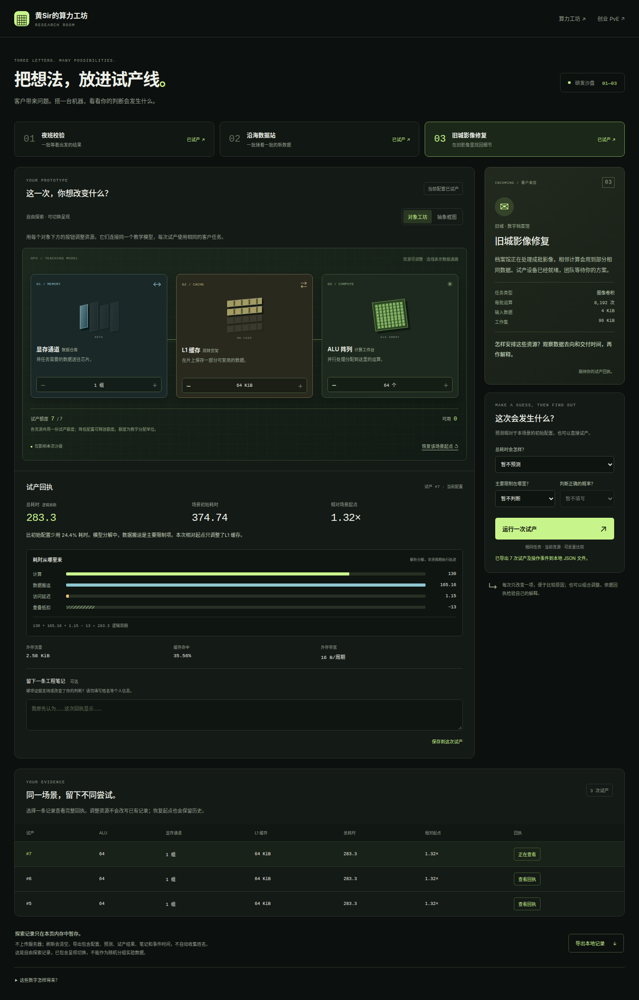
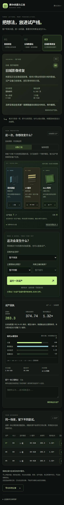

# GPU 试产实验室验收

日期：2026-10-19。入口 `/web/game/lab/`，原型 `gpu-exploration-prototype-2`；教学模型 `analytical-compute-memory` v1。

本记录是软件与界面验收，不包含参与者数据，不能证明学习收益或趣味性。

## 自动验证

- `npm test`：284 项通过，其中 16 项为探索实验室规则测试。
- 遍历三个场景的全部可行资源组合：对象化与抽象条件的配置、预算、周期及吞吐一致。
- 超额分配不修改配置或日志；降低其他资源可以释放额度。重置恢复固定起点并保留所有运行。
- 每次运行保存当时的配置、单项／组合变化、预测、预算、结果和解释修订。编辑配置不覆盖已有结果。
- 首次未运行的预测、跳过、看过结果后再次预测分别记录；新场景不会继承其他场景的曝光标记。
- 真实事件时间有限、非递减，与模型逻辑周期分开。超过 1,200 次操作后导出仍保留完整事件，导出对象与原状态相互独立。
- `npm run validate`：七份既有轨迹全部通过。
- `npm run build`：实验室页面、样式与共享引擎进入静态产物。既有静态服务器测试覆盖新入口和模块路径。
- 研究协议 JSON 可解析，`git diff --check` 通过。

## 浏览器流程

Google Chrome 155、Playwright，1440 px 桌面与 390 px 手机。分别验证自由探索、固定对象化、固定抽象三个入口，共六种组合；没有 JavaScript 异常或失败资源请求。

1. 三封来信均可进入，不需要经营存档或挂机解锁。
2. 调整资源后提交预测并运行，回执显示固定场景基线与候选配置的耗时、分解、流量和命中率。
3. 额度用尽时增加资源的按钮禁用；恢复起点后可继续分配。
4. 已显示回执不会随草稿配置变化而改变，页面明确提醒它属于此前的配置。
5. 解释归属具体运行；含 HTML 字符的笔记作为文字处理，原文保留在 JSON 中。
6. 三个场景和运行历史可往返；重置保留已有记录。
7. 固定条件入口隐藏切换控件。自由切换保留配置和数值机制，并在导出中标明自由探索及切换。
8. JSON 下载包含配置、预测、解释、模型与场景版本、事件顺序及真实相对时间；未把 URL 条件称为随机分配。
9. 手机依次呈现来信、资源、预测／试产、回执。键盘跳转入口可聚焦，减少动画设置生效；页面无横向溢出，历史表在自身区域滚动。

另以构建产物模拟 GitHub Pages 的 `/GPU-sim/` 前缀，在 320 px 视口打开固定抽象表示和复用场景，验证模块路径、运行与无页面横向溢出。跨 320／1440／390 px 调整时同一预测面板按顺序迁移，输入概率须先有具体判断才启用。

例如，相同操作序列在两种固定表示下得到相同结果：夜班校验从 90.16 周期降到 54.20，再到 35.60；重置后恢复 90.16。沿海数据站增加两档 DRAM 后为 101.08，旧城影像增加两档 L1 后为 283.30。它们仅用于软件回归，不是实测 GPU 基准或用户学习成绩。

## 数据与研究边界

会话只在当前页面内存暂存，刷新／关页会丢失未导出的内容。没有后台上传、随机分配服务、正式题本交付、联系信息管理或延迟测验服务。相对经过时间可能包含失焦和阅读，不能直接当作主动投入时间。

耗时条表示解析分解，图形不代表逐周期执行或芯片物理布局。试产额度是虚构教学约束，不是实际价格、面积或功耗。后续依照[先导手册](research/gpu-exploration-pilot.md)审核题目并组织形成性观察，再决定正式研究。

