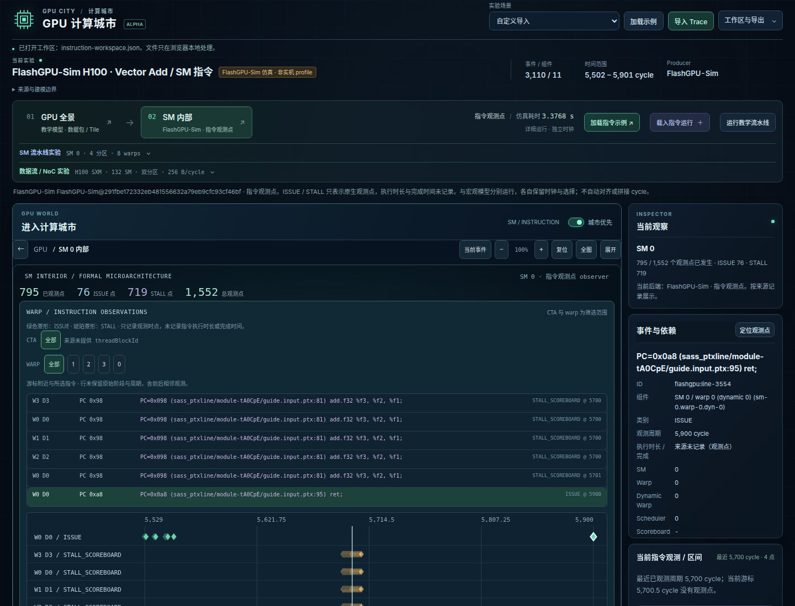

# SM 原生指令 trace 接入验证

日期：2026-10-15。本页记录原 ISSUE/STALL 点日志的首次接入；后续新增的原生阶段与组件内光点见 [SM 光点验证](sm-light-validation.md)。Accel-Sim 2.0 尚需输出 observer。

## 原生后端与产物

固定官方 FlashGPU-Sim commit `291fbe172332eb481556632a79eb9cfc93cf46bf`，未修改其执行实现。使用 CUDA 12.8、GCC 13.3、单 OpenMP 线程，在 CPU 上以官方 `SM90_H100` 配置运行本仓库的 256 元素 vectorAdd（2 CTA × 128 threads）。全部 256 个结果通过 CPU 参考精确校验。

| 实际记录 | 结果 |
| --- | --- |
| 指令观测 | 3,110 条：176 ISSUE、2,934 STALL_SCOREBOARD |
| 原生归属 | 2 个有记录的 SM、8 个 warp |
| 指令点时间范围 | 原生 GPU total cycle 5,502–5,901 |
| 后端报告 `gpu_tot_sim_cycle` | 6,212；与指令观测窗口分别保留 |
| 本次 workload 进程墙钟时间 | 3.376846945 s；包含启动、PTX 提取、仿真、输出及数值检查，不含编译及 JSON 转换 |

[完整日志](../examples/flashgpu-vectoradd.log)、[统一 trace](../examples/flashgpu-vectoradd.json)、[capture manifest](../examples/flashgpu-vectoradd.manifest.json) 共同保留版本、源码/config/runtime/log/JSON SHA-256、launch、采集参数、时间域及测量范围。可选 [runner](../tools/detailed/run-flashgpu.mjs) 清理旧对象并固定 tracing 编译参数，支持独立复现；[操作说明](../tools/detailed/README.md)。

这是执行驱动的 PTX 指令观测。重复 PC 和各次 stall 均保留，不当作唯一动态指令或完成区间。原生日志没有完整 Fetch/Decode/Execute/Writeback、CTA identity、active mask 和依赖边；正式架构图中未映射组件保持未观测。`STALL_SCOREBOARD` 是后端的原始复合 readiness 标签，不自动证明 RAW 等待。其观测覆盖也不保证完整多发射记录。

## 自动与浏览器检查

- 原始日志重新导入后逐事件匹配提交的 trace；SHA-256、来源行号、阶段计数、cycle 边界、功能校验标记及测量范围一致。
- 有限轨道窗口随游标更新，保留选中的较晚事件；点观测与非零区间分别计数，未从未来点生成当前状态。
- Chrome 桌面 1440 px、手机 390/320 px：首次点击 SM 内部载入样例；PC/warp 搜索、阶段筛选、点选择与精确定位、当前/最近周期观测、原生日志导入均通过。
- 宏观位置 1,000 与指令位置 5,700.5 分别恢复；工作区导出再导入保留两份运行及各自位置。无页面异常或 HTTP 错误，手机无页面横向溢出。
- `npm test`、`npm run validate`、`npm run build` 通过；测试覆盖真实产物一致性、工作区、原生点语义、轨道选择及现有模型回归。

