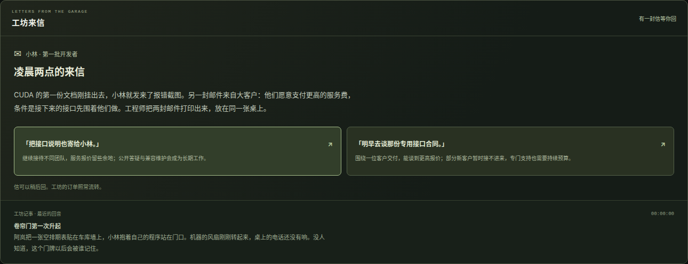
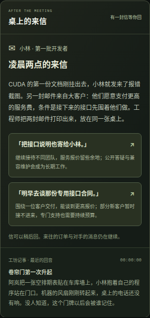

# 剧情与尾声验收

日期：2026-10-16。页面 `/web/game/` 与 `/web/game/pve/`。

## 自动检查

- `npm test`：268 项全部通过，包括 14 项独立剧情规则检查及工坊、PvE、财务集成回归。
- 三段往来依次由已安装能力与经营规模触发；未到来的信件、无效答复及重复回信不会改动账本。
- 不同答复实际改变客户单价、到单、需求、项目交付和持续费用，不凭空生成资金或单颗 GPU 吞吐。
- 工坊保留旧客户与扩展交付各有实际收益，持续费用没有收费的模式也能体现经营取舍。
- 六十秒后的回信只出现一次，长时间离线和连续推进得到相同文本、时间及经营结果。
- 至少五份不同经营尾声分别由具体承诺与系统投入产生；另有停业与一般成长尾声。未达成时，界面数据不返回结局目录。
- PvE 对手先交付仍允许玩家完成自己的故事；先发、并列、后到分别保留正确事实。只有两位对手并列时，玩家不会被写成共同获胜。
- 破产档案不再出现后续续单，已获得尾声不会被未来研发、现金变化或刷新重写。
- 恢复存档重建规范文案、已选择项与达成事实；旧通关存档可以先体验回顾来信。
- `npm run validate`：七份既有轨迹通过；`npm run build`：三个页面及新剧情模块均正常构建。

`npm run benchmark:pve` 仍得到原有三种从零经营结果：主动均衡投资 569 秒玩家获胜，完全挂机 1,334 秒灰盒获胜，计算过度扩张 821 秒破产。这些基准没有自动替玩家答复来信。

## 浏览器交互

Google Chrome 155，Playwright，本地静态服务器。分别检查 1440 px 桌面与 390 px 手机视口；剧情 UI 测试使用满足硬件和资金条件的夹具存档，从零经营可行性由上面的独立策略验证。

1. 新开工坊显示开门场景，尚未到来的提案和选择不出现。
2. 通过页面批准工具链提案后出现第一封信；两份答复可点击，未达成尾声保持隐藏。
3. 回信后显示即时回音，刷新保留答复；后续研发与经营自然带来网络及部署事件。
4. 合作已经签订时，另一份未签提案不继续作为路线对比表展示；实际价格和可展开的预算细节仍可查阅。
5. 工坊经历三段往来并达成规模后显示已获得尾声，刷新仍保留；PvE 仅有答复不会提前结束，完成玩家自己的商业首单后才收束。
6. 暂停 PvE 后回复按钮禁用，恢复后可回信。尾声按钮返回经营区域，没有强制重开。
7. 旧工坊通关存档仍能收到新增来信，不会刚恢复就跳过所有选择。
8. 桌面、手机页及待回复选项无横向溢出，无 JavaScript 异常或失败资源请求。

截图只记录当前来信，不展示尚未达成的尾声。

