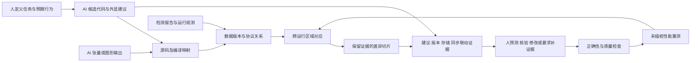

# 面向人类理解的 AI 辅助 GPU 编程：可视诊断与优化研究规划

制定及修订日期：2026-10-23。文档类型：研究规划与证据设计，不是已完成论文或实验报告。修订基线：`2d3c7b7`。本次将 AI 辅助编程中的人类理解纳入主问题，负载覆盖 AI、通用计算与图形，不再以图形应用数量限定范围。以下样本量、案例数、时间预算均为计划值。

执行记录：[模型与 SM89 实机先导](experiments/2026-10-23-pilot/report.md)、[多卡 trace 复用实验](experiments/2026-10-23-multigpu/report.md)、[逻辑版本与协议证据实验](experiments/2026-10-23-semantics/report.md)。已完成对应/切片开发验证、真实 CUDA 数值与性能测量，以及用户指定 `/home/liuwei/GPU-simulator` 中四卡 457 份 trace 的来源核验；另纳入五卡 launch 级记录。本轮进一步恢复 13 个完整已记录 CTA，建立有限三值检查器，并将 SM89 受控错读版本的实际输出/tag 接到检查、切片与可视界面。现代卡历史 trace 的完成/版本义务仍保留 unknown；尚无真实现代异步 bug/fix、AI 解释或开发者评价，不能将本规划全部标记完成。下一步优先语义采集，资源与验收条件见[执行清单](semantic-next-stage.md)。

## 1. 研究定位与投稿选择

建议题目：**让开发者理解与核验 AI 生成的 GPU 算子：基于数据版本和执行差分的可视分析**。

英文工作标题：*Understanding and Validating AI-Generated GPU Kernels through Version-Aware Visual Analysis*。

研究对象是 **AI 辅助 GPU 算子开发中，人如何理解、核验和改进候选实现**。AI 可以生成代码、提出解释并利用执行反馈修复，但这些能力不能替代对人类理解的测量。主问题是：当 AI 修改流水线、tile 布局或同步时，怎样把其改动和解释连接到可核验的执行证据，让开发者判断哪些建议成立、哪些错误、哪些证据不足，并在新任务中独立推理？技术内核仍是跨运行数据版本对应与证据保留切片。

**“AI 生成代码”和“AI 工作负载”是两个独立维度。** 前者描述代码来源，后者描述计算任务。attention/MLP 可以由人编写，transpose 可以由 AI 编写；神经渲染又同时属于 AI 与图形负载。系统支持人写及 AI 修改的 kernel，不以来源作为正确性标签。

| 代码来源 | AI 工作负载 | 通用计算/图形工作负载 |
| --- | --- | --- |
| 人编写/维护 | attention、GEMM/MLP、normalization | transpose、scan、图像处理、rasterization |
| AI 生成/修改 | AI 提出的 attention/MLP 版本与优化 | AI 提出的搬运、归约或图形算子版本 |

### 1.1 按贡献选择载体

| 目标 | 本研究应形成的主要论证 | 决定性证据 | 投稿身份与规则边界 |
| --- | --- | --- | --- |
| **IEEE VIS / TVCG**，保留方法主轴时的首选 | 面向 AI 辅助 GPU 开发的数据抽象、差异表示与证据核验工作流 | 对应/切片质量、规模与成本、独立理解及诊断任务、真实 AI/GPU 案例 | VIS full papers 发表 TVCG；2026 为 9 页内容加最多 2 页指定附属内容。用户研究不是所有论文的统一硬要求，本研究的人类理解主张需要直接任务证据。[S3][S4] |
| **CHI / TOCHI**，人的理解与控制成为主贡献时优先 | 哪种交互能帮助人理解和核验 AI 代码、校准依赖并迁移到新任务 | 领域需求、设计机制、相同 AI/证据下的受控研究、无 AI 迁移；技能保持主张另需延迟测验 | CHI 接收交互系统与编程工具贡献；TOCHI 为对应 HCI 期刊路线，当前完整作者规则待核查。[S7][S8] |
| **ACM TOG / SIGGRAPH Journal track**，条件性路线 | 对图形/交互社区有实质价值的 GPU 编程与分析方法；允许 AI 负载 | 方法有效性及与该社区相关的应用/交互价值，不预设必须两个图形应用 | Journal track 发表 TOG；Conference track 是会议论文集。GPU/AI 不因名称被排除，仍须论证社区贡献。[S1][S2] |
| **EuroVis / CGF**，相近可视分析路线 | 与 VIS 同一研究内核，强调分析任务、表示及领域有效性 | 领域需求、方法、定量分析和使用证据 | 2026 full papers 发表 CGF 特刊，正文 10 页、参考最多 2 页；后续届次必须重新核对规则。[S5] |
| **HPG / PACMCGIT**，性能方法路线 | 如果最强贡献变为低开销分析、优化选择或执行机制，围绕图形性能组织论文 | 未插桩应用时间、质量、工具成本、规模与机制消融 | 2026 HPG 录用论文发表 PACMCGIT，不是 TOG 或 CGF；2027 CFP 尚待核查。[S6] |

当前主投顺序按贡献确定：跨执行表示/证据切片最强则 VIS/TVCG；人的理解、核验与交互设计最强则 CHI/TOCHI；对图形与交互社区有充分新价值时保留 TOG。选择能够暴露不同 GPU 机制的真实负载，不为 venue 凑图形案例。它们的贡献重心不同，不按“换个标题即可转投”设计；案例数量和实验形式均不是录用规定。

截至本日期，SIGGRAPH 2027 官方页列出论文截止为 **2027-01-29 06:00（北京时间）**，但详细投稿说明仍待公布。当前到该日期约三个月，不应据此承诺完成本方案的全部证据；下一合适会议周期或期刊路线以完成度决定。[S2] 本文不把 2026 页数、匿名或轨道规则当作 2027 已确认要求。

## 2. 整体 motivation：从一个具体失败引出统一问题

### 2.1 面向论文引言的论证

现代 AI 与通用 GPU 工作负载包含 GEMM/MLP、attention、normalization、归约、数据重排，以及神经渲染和图像处理。高性能实现把数据搬运、矩阵计算与结果消费组织成重叠流水线；逻辑数据被分块，同一片局部存储反复容纳不同版本，执行者通过完成令牌和同步协议交接所有权。这些交接错误可能表现为错误张量、偶发失败、挂起或性能回退。源码顺序、实际可见性与硬件资源竞争并不等价，因此仅阅读生成代码及其文字解释存在明确的信息缺口。

AI 已经能够生成、编译、测试和迭代优化部分 GPU kernel。KernelBench 评价生成代码的正确性与速度，SOL-ExecBench 提供来自真实 AI 模型的硬件执行任务；相关 agent 也能利用 profiler 反馈。[R12][R13][R14] 本研究不建立在“AI 不会调试”的假设上，而是研究 **生成/优化的结果如何转化为人能核验的机制理解**。一次通过测试和一段流畅解释，分别不足以证明任意输入下正确或人已经理解了执行。

例如一个循环复用的 SMEM stage：上一轮输入已到达，不代表所有计算消费者已经完成使用。新版本过早覆盖旧版本可能引发错误；反过来，保守地等待全部操作又可能消除原本合法的重叠。修改 stage 数或 tiling 后，动态事件数量和存储映射随之变化，逐时间点或逐指令比较难以说明究竟修复了什么、损失了什么。

已有检测器能够发现许多同步与内存错误，已有可视分析能够揭示等待原因，已有 trace diff 能比较多次运行；LEAP 和 Ivie 还直接研究了 AI 代码的运行时核验和就地解释。[R15][R16] 因此待解决的问题应限定为：**当 AI 改变 GPU 执行组织时，如何保留逻辑工作、数据版本及协议证据的对应，使人能够检验解释、预测改动后果并独立处理新情况？**

核心洞见是以**逻辑数据域和版本**作为跨执行的锚，以**异步协议义务**约束可折叠的证据，让 AI 的外显建议、人的预测与实际观测指向同一组对象，再把候选修复或优化交给完整重执行验证。用户可以查询“这条建议依赖什么条件”“哪个版本仍在使用”“下一次运行能否反驳这个解释”。仅增加聊天入口不构成这一机制。

### 2.2 初始 motivating example

首例采用单 CTA、warp-specialized、两级/三级缓冲的 GEMM：TMA 将输入放入 SMEM，tcgen05 MMA 使用输入并写入 TMEM，epilogue 消费结果。准备四个程序版本：正确基线、提前复用的错误版本、过度串行化的正确修复、保留合法重叠的候选修复。最后一种是否更快由实测决定，不能预先保证。

加入一个待构造的 AI 建议：“删除这次等待仍安全，并能增加重叠”。系统将建议指向相应消费者、数据版本和完成义务；用户先预测，再查看证据，选择采用、拒绝或补充测量。建议也可以正确，不能把所有 AI 输出预设为错误。AI 自述不充当真值。

应用层首先落实到 attention 的 batch/head/query/key 区域或 MLP 特征输出，也可落实到像素。数值错误、模型允许的潜在竞态、无法判断的关系与测得的性能回退分别展示。

### 2.3 “让人理解”如何变成可检验问题

理解至少体现为：能预测未执行修改的后果；能指出决定判断的数据/同步关系；能识别结论的适用条件和证据不足；撤去辅助后，仍能处理未见任务。代码完成率、主观满意度、解释流畅度和人类理解分开评价。

关于 AI 与编程技能形成的 2026 作者预印本表明，在其 Python 异步库学习任务中，完成任务与理解结果可以不同。[R17] 它只提供研究动机，不能直接证明 GPU 开发者会退化，也不证明本可视系统必然改善理解。我们的主假设是：**相同 AI 候选和执行证据下，版本/协议联动表示能否改善独立判断与迁移，同时报告其时间成本。**

## 3. 相关工作的已解决问题与剩余任务

表中的“剩余任务”是本项目待验证的切口，不表示相关工作在所有情况下不能完成该任务；文献未展示不等于理论不支持。

| 最近邻 | 已解决什么 | 本研究必须进一步证明什么 |
| --- | --- | --- |
| Duca 2005，TOG；Hou 2009，TOG | 跨图形阶段关系查询、输出来源；GPU 内存数据流记录、错误回溯与可视化 | 现代复用缓冲及异步协议下，跨执行的逻辑数据域对应与证据保留；“点像素看来源”不单列为贡献。[R1] |
| Daisen 2021，CGF；Milestone 2026，VIS/TVCG 待刊 | 组件/任务/依赖探索，阻塞原因及跨层上下文；支持分析和验证优化机会 | 两次执行的组织改变后，怎样对应逻辑工作、区分不同解释并验证干预；“解释为什么等待”不是新主张。[R2][R3] |
| Compute Sanitizer、ConSan | TMEM guardrails、异步访问、barrier 与可见性等检查，具体能力依版本与配置 | 将已有检测结果接到数据版本、源码及修复差异；优先复用检测能力，不冒称全面超过现有工具。[R4][R5] |
| SentryWard，作者研究项目 | 支持范围内的 phase/HB、存储生命周期及同步删减验证，已有复用错误解释 | 重 tiling/流水线改变后的多对多对应，以及保留证据的差异抽取；phase 图、验证删除 wait 本身不新。[R6] |
| KPerfIR / Proton | 编译器内 profiling；现有工具支持跨 region 的异步事件身份 | 事件身份仍需与逻辑数据域及协议义务关联；不能声称首次配对异步起止。[R7] |
| HTA、TraceLens | 多次 trace 比较；TraceLens 支持层级结构对应及同一高层操作不同 leaf 的比较 | 对应进一步深入 kernel 内部的数据区域/版本，并保留异步协议的违例证据；不能声称首次语义 trace diff。[R8][R9] |
| Halide、Piko、Spire；Coz | 调度表达、优化选择、通过干预分析优化潜力 | 此处聚焦有证据的诊断与改动验证，不另做通用可视编程语言，也不把 what-if 视为新颖性。[R1][R10] |
| KernelBench；SOL-ExecBench | AI 生成 GPU kernel 的正确性与性能评测；实际 AI 模型算子与硬件执行 | 生成得对/快不能直接回答人是否理解、是否能审核建议；复用其适用任务，不以旧模型分数代表当前能力。[R12][R13] |
| KernelAgent；KernelBlaster 等 AI kernel 优化系统 | 已有 profiling、带 metric 证据的诊断、解释/修复建议、数值检查、多轮改进与历史记录 | 自动闭环与人类机制理解分别评价；“AI 有理由的建议”“闭环验证”“带 UI”本身均不构成新增贡献。[R14][R18] |
| LEAP，CHI 2024；Ivie，CHI 2024 | 用运行值或代码旁解释支持核验和理解 AI 代码 | 针对 GPU 非顺序执行、复用存储、异步协议和跨实现变换，证明新增表示与证据操作的必要性。[R15][R16] |
| How AI Impacts Skill Formation，2026 作者预印本 | 将 AI 辅助任务完成与即时概念理解、读代码、调试测验区分 | 在 GPU 专业任务上独立检验，不外推长期技能或所有 AI agent 的因果效果。[R17] |

与新近形式化/验证预印本 AI as a Compiler、RESOLVE、Racer 的能力矩阵需在第一阶段冻结版本后精读更新，避免首稿建立在过时空白上。[R11]

## 4. 研究问题与候选贡献：集中为三条

| 研究问题 | 候选技术贡献 | 必须建立的证据 |
| --- | --- | --- |
| RQ1：同一存储地址被复用、同一逻辑工作被重分块时，怎样可靠对应？ | **带版本和证据来源的跨层对应方法**：以逻辑坐标域及生产/消费版本建立区域关系，显式处理一对多、多对多、未匹配和不确定对应 | 小实例独立映射真值、跨 tiling/stage 改动的对应准确性与覆盖率；复杂度及规模实验 |
| RQ2：怎样压缩到能核验的解释，又不丢失决定性义务？ | **保留违例见证与未决义务的差异切片**：从输出/告警出发，保留冲突双方、存储代次、完成/可见性证据与相关执行变化 | 见证/证据保留检查；与全图、普通祖先切片和无版本切片比较；保留率、大小、时延和错误解释率 |
| RQ3：这种对应与切片能否帮助人理解、核验和改进 AI 候选？ | **AI 建议、人的预测与执行证据共享语义对象的交互机制**：外显主张定位到数据/协议，用户判断、查证和重跑，保留未知 | 相同 AI/证据下的独立理解与建议核验任务；修复隐藏验证；未插桩算子/AI 应用结果；不同证据链分别报告 |

RQ1/RQ2 是候选方法贡献，需通过最近邻复现与消融证明增量。RQ3 可以是充分验证的系统/交互贡献，不要求再发明通用优化器。若 RQ1/RQ2 最终仅是已有技术组合，必须转而证明集成带来的独特任务能力，或收缩论文主张。

第一篇不同时承诺：全 ISA 正确性证明、精确 Blackwell 周期仿真、任意 CUDA 自动转换、自动修复任意 bug、TPU 后端、自动探针选择或开放世界游戏学习效果。后续扩展不作为本篇验收依赖。

## 5. 整体框架与核心机制

### 5.1 输入及执行契约

首个前端选 Triton/Gluon，以便复用其异步操作表达、ConSan 与 Proton。源码标记/编译映射记录逻辑数据域及源位置；AI 模型或图形应用通过明确的算子接口接入。CUDA/CuTe 来源的 kernel 若需要移植，单列移植成本和语义/质量对照，不当作系统已经支持第二前端。AI 生成的映射注释同样需要独立核验，不能因由模型提供就作为真值。

每次运行保留 `run_id`、源码/编译产物哈希、GPU、驱动、编译器、shape/stride、精度、输入身份、配置和采集能力。性能构建、插桩构建、验证构建分别标识。首个 SM100 实验限定 `cta_group::1`、单 CTA、2–3 stage、少量合法 layout；通过后扩展真实多 CTA grid，暂不引入跨 CTA 同步与 multicast。

### 5.2 版本与关系表示

| 实体/关系 | 所需信息及用途 |
| --- | --- |
| 逻辑数据 | 应用对象、tensor、坐标区域、语义迭代/归约域；分别记录规范要求的版本与实际观测/可推导的来源，后者不可知时标 unknown；不将 CTA 编号视为跨执行身份 |
| 物理存储 | allocation 身份、地址空间、区域、layout、复用代次；同地址可以有多个逻辑版本 |
| 执行操作 | 生产者/消费者、源/IR 位置、操作种类、读写域、所属 run |
| 协议义务 | 适用的完成、可见性、计数/代次、复用/释放条件及规则版本 |
| 证据 | 实机观测、编译映射、ISA 推导、受限模型、人工标签；保留原始事件指针和未观测范围 |

使用分类型关系图，分别存放数据来源、存储别名、ISA 建立的先后/可见性、观测等待和跨运行对应。它们不能混为一种“因果边”。barrier 记录完整逻辑代次，不仅记录循环重复的 parity；issue、completion、visibility、safe reuse 各有语义。

设备插桩点或 wait 返回时间不直接代表异步硬件真实开始/完成时间。缺失记录不代表没有同步。缺少规则或观测时返回 unknown；若支持模型枚举给出反例，则标为模型允许的违例，不自动称为实机已发生的错误。

### 5.3 跨运行对应算法的初始设计

1. 依据共同的预期算子规范与输入身份建立逻辑输出坐标域；被调试程序可以违反规范，不以它已经正确为配对前提。
2. 用区域交集建立操作/存储版本的候选对应。例如一个大 tile 与两个小 tile 对应，保存覆盖区域和比例，而不强迫一对一。
3. 结合预期的计算角色、逻辑迭代和归约域核验任务对应；将实际生产来源、消费版本及顺序作为被比较的对象。某消费任务本应读取 `A[k]` 却读取 `A[k+1]` 时，仍对应同一预期任务并标出来源差异，不能因版本错误而排除匹配。形状相同或名称相同不足以成立，无法确认的映射保留未匹配。
4. 在对应区域上比较协议义务、依赖、观测等待与性能结果，区分预期的组织变化和需解释的变化。

GEMM 的数值重关联可以改变舍入；Gaussian blending 的前后顺序可能改变语义。区域对应本身不证明数值等价，必须由独立数值/质量检查补充。初期只支持已定义映射规则的改动，静态索引到数据依赖地址的推广另列范围。

### 5.4 差异切片及保留条件

给定输出异常、检测器告警或性能回退的 seed，提取两侧相关区域及版本，再沿生产消费、存储复用和协议关系扩张。切片的终止条件应是相关义务已由证据封闭，或明确记录仍未解决的外部条件。

正确性切片至少保留：冲突双方与地址域、逻辑版本/分配代次、相关完成令牌与规则、必要的路径/同步信息和原始证据。若报告“缺少某种次序”，须有相应范围内的完整规则/观测支持；不能靠删掉边来制造缺失。

性能切片还必须考虑不在数据依赖祖先中的竞争者及资源释放事件。实机证据无法充分识别资源竞争时，报告可见差异并提出可检验假设，不输出唯一根因。第一版可以保留完整相关资源窗口，以保真优先；不声称得到全局最小解释。

需论证并测试的性质包括：区域覆盖的一致性、对应关系的类型正确性、切片对指定违例见证的保留，以及 unknown 在摘要中的传播。证明范围限定在定义好的关系模型，不替代 ISA 实现验证。

### 5.5 可视交互与实际改动

提供四个联动视图：图像/张量输出；逻辑版本到物理 stage 的占用；异步操作与协议义务；两次运行的对应与差异。颜色区分观测违例、模型反例、性能差异和未知，不把所有异常都画成确定错误。

支持的操作是选择输出、查询其来源、检查复用、比较修复前后、查看证据并触发重跑。修改范围从已有实现模板中的 stage 数、合法 tile/layout、wait 位置和 epilogue 分组开始。任何性能建议先生成可执行候选，经正确性检查后测量；保留失败、无收益与回退候选。通过有限测试的候选称为 tested-valid，不标为全域已证明安全。

### 5.6 AI 与人共享的建议—证据接口

为每条待核验建议记录：候选代码哈希、修改位置、预期效果、涉及的逻辑对象/协议义务、适用 shape/精度、支持证据、未决条件和下一项可执行检查。连接的是 AI 的外显主张与工具证据；原始模型文字保留，不能把解析失败的主张悄悄补成确定事实。

例如“这里的 wait 可删除”必须绑定具体版本与消费者；“改成三 stage 会更快”必须绑定配置与测量范围。系统分别标识提出的假设、已观测事实、模型推导和未解决问题。错误证据引用、跨 run 混用或过期代码版本要能被发现；自然语言与证据的实质对应由可检查规则和独立评价验证，不承诺自动判断所有解释真伪。

人可以先预测，再查看证据并选择采用、拒绝或追加检查；自由工作模式不强迫每次操作完成教学问答。AI 可通过同一对象/查询接口提出下一步，只有外部检查支持的结果进入已验证状态。系统的可视表示、解释文本与结果来源都可单独做消融，不把换一个更强模型的收益归给界面。

## 6. 实际 apply：以 AI 算子为主，覆盖不同 GPU 机制

### 6.1 算子层验证集

计划优先覆盖：多阶段 GEMM/fused MLP；attention 中的搬运、矩阵计算及归约交接；softmax/RMSNorm 等归约和存储访问任务。矩阵流水线验证 TMA/tcgen05，归约/存储任务检验框架是否超出单一指令模式，不强迫所有算子使用 Tensor Core。图形 blending 或图像处理作为跨任务扩展，由实际证据和投入选择。

每族选择整齐与非整除 shape、资源阈值两侧、不同迭代次数、合法 layout 和无收益配置。先固定一种输入/累加精度，再增加第二种；数值范围变化与性能规模变化分开设计。

### 6.2 AI 主负载与模型集成

| 负载族 | 对应锚与理解任务 | 实际评价边界 |
| --- | --- | --- |
| GEMM / fused MLP | batch/token、输出 feature、归约域；理解 stage、复用及 epilogue 修改 | 数值与协议验证、算子延迟；若替换模型层，纳入转换与调用成本 |
| attention | batch/head、query/key 逻辑位置、mask、部分归约状态；理解错误 mask、版本交接与阶段改动 | 固定语义的 prefill 子集起步；decode、KV cache 或 backward 分别扩展，不能由一个版本外推全部 |
| softmax / RMSNorm / 数据重排 | 行/元素域、归约贡献与输出映射；区分数值范围、索引和存储问题 | 独立高精度 reference；不把非异步数值问题硬归因于 barrier |

从 KernelBench 和 SOL-ExecBench 的公开任务中按机制和支持范围选取子集，保留原任务及工具版本，并补充独立边界输入/shape。其测试不是全域正确性证明，旧榜单成绩也不替代本研究复测。[R12][R13] SOL-ExecBench 中拟加入新评分 baseline 的候选仍需人工审阅，这说明证据审核是实际任务；本方法不声称覆盖其报告的所有计时或功能违规问题。

至少选择一个有明确真实调用路径的 AI 模型 block 或推理应用进行算子替换，固定模型版本/权重、batch、序列长度、精度和执行模式。先确认目标算子的占比，再报告 operator、block 和完整请求的时间边界。若只完成 block 集成，结论只写 block 结果；声称完整模型加速时必须实际端到端测量，不能用 kernel speedup 外推。

### 6.3 图形与神经图形扩展案例（按研究需要选取）

| 候选应用 | 为什么适合 | 输出到执行的锚 | 错误与优化任务 | 必须报告的限制 |
| --- | --- | --- | --- | --- |
| **GEMM-GS / 3D Gaussian Splatting 的 forward blending** | 作者方法把 blending 组织成 Tensor Core GEMM，代码包含双缓冲与异步复制，是真实图形算子 [A1] | view/frame、pixel、稳定 Gaussian ID；排序位置是需比较的顺序关系，不是身份 | 追踪异常像素涉及的数据版本；比较缓冲复用、分块与同步改动；验证渲染输出与帧时间 | 现有公开实现使用 `mma.sync`、`ldmatrix` 与 pipeline async copy，不是现成 tcgen05/TMA。SM100 移植是待做工作；先限定 forward，不承诺训练/梯度支持 |
| **Instant-NGP / tiny-cuda-nn 的神经场查询或 fused MLP** | 原系统使用融合 CUDA 神经网络，直接参与图形表示和渲染 [A2][A3] | 原始 ray ID、固定采样坐标/参数、层与 feature 域；压紧后的数组下标不作身份 | 检查融合层之间的布局/版本交接；比较阶段安排与 epilogue；观察误差如何影响输出图像 | 首先测 profile，确认待研究 kernel 在实际路径及其占比；小网络可能不适合 tcgen05，不能预设迁移有收益 |

若第二案例的移植和观测成本不合适，可在第一阶段选择 **Open Image Denoise** 的实际卷积/融合层作为替代。它是开源的光线追踪图像去噪库并支持 NVIDIA GPU，但其当前具体 kernel、指令路径和可替换接口仍需代码审查；不把库支持 Blackwell 写成其必然使用 tcgen05。[A4]

上述候选是应用入口，不是已发现错误的项目名单，也不要求第一篇全部接入。若选择图形主案例，可规划 2 个开发场景和至少 6 个保留场景/图像，按完整场景分割；帧是重复观测，不当作独立场景。固定相机、checkpoint、分辨率、精度和渲染设置；若改变近似、排序或剪枝，则单列质量—性能比较。

神经场首阶段固定采样集合。后续加入 compaction、剔除或 early termination 时，明确记录新增/消失的逻辑工作；不能为提高匹配率，把不同采样点或不同 Gaussian 强行对应。

### 6.4 三个论文叙事案例

- **审核 AI 的错误或未被支持的建议：**从候选及输出区域进入，追踪版本/义务；用户能够拒绝错误、识别证据不足，并解释原因。正确建议同样纳入，防止把一律拒绝当作理解。
- **正确但变慢的修复：**同样正确的两个修复产生不同重叠与资源占用；人先预测并说明理由，再用对应证据与未插桩实测评价代价。
- **优化的适用范围与人的迁移：**一个修改在部分 shape/场景上有效；在新的 kernel/布局下，检验用户能否独立判断相关规则是否仍适用。

同一框架应完成候选→人的判断→执行证据→改动/拒绝→独立验证的闭环，并单独测无辅助迁移。城市动画、代码截图或优化后的单一数字不能替代这些记录。

## 7. 实验基础设施与数据划分

### 7.1 硬件与可复现身份

最低实机条件是一张可稳定重复运行的 SM100/B200 级设备，具备编译、sanitizer、profiler 权限及足够的独占测量窗口。不能用 SM120/RTX 5090 替代 tcgen05/TMEM 实验。第二 GPU 若加入，仅在共同支持子集评估可迁移性，不强求同一 ISA 路径。

记录 GPU/CPU/内存、OS、驱动/CUDA、Triton/Gluon、检测器、profiler、编译参数与 commit；记录时钟/温度/并发负载状态。应用、输入、版本、变更、测试结果和时间样本通过 manifest 关联。现有 trace 来源与回放基础可复用，教学模型与 FlashGPU-Sim vectorAdd 不充当 SM100 真实性证据。

### 7.2 Ground truth 与案例规模

| 数据集 | 规划规模及分母 | 独立判定方法 |
| --- | --- | --- |
| 语义微程序 | 先构造 20–30 组正确/错误协议对照；规模依支持子集调整 | 公开 ISA 规则、小状态枚举和两名独立审查者；不由系统自己的 ID 生成器给自己打分 |
| 错误案例库 | 目标 24–40 个独立根因；其中争取 6–12 个真实公开/开发错误，其余为明确注入 | 原项目版本、复现、修复和根因记录；数值检查及规则审计；数量达不到时据实收缩 |
| 合法复杂对照 | 20–30 个并发/复用/不同合法等待方式的程序配置 | reference 与协议核查；不只用完全串行代码测误报 |
| 算子性能与对应集 | 每已实现任务族先规划 8–12 个 shape/stage/layout 配置，保留整类未见改动 | 独立坐标枚举、数值 reference、完整重执行；实际数量随支持范围冻结 |
| AI 应用 | 至少一个真实模型 block/应用；按 batch、序列长度、精度与资源区域冻结保留配置 | 固定模型/权重/输入和数值标准；operator、block、完整请求分开计时 |
| 图形扩展 | 按需要选择；每个主案例可规划 2 个开发场景及至少 6 个保留场景 | 固定 checkpoint/输入与质量标准，实际 kernel 及端到端测量 |

错误类型覆盖 barrier 代次/计数、适用的可见性规则、SMEM/TMEM 提前复用/释放、descriptor/layout 错配。一个变异模板在不同 seed/shape 上重复仍算同一根因；每个根因可带 3–10 个触发实例，但分开计数。真实错误与注入错误分别统计，开发集与保留集按程序家族/根因拆分。

数值 reference 先将输入舍入到目标输入格式，再用更高精度独立计算；按算法、精度与归约长度预先确定容差。报告最大绝对误差、相对范数误差、超容差元素比例及 NaN/Inf。sanitizer 是辅助证据，不是唯一真值；超时不直接等于已证明死锁。

### 7.3 AI 候选及解释语料

先冻结任务提示、模型/版本、采样参数、工具权限、重试轮数与 token/时间预算，保存全部候选、诊断和结果。至少区分：正确且有效、正确但无收益/退化、协议/数值错误、编译失败/不支持。**代码正确与解释正确分别标注**：正确代码可以附带错误理由，错误代码也可能有局部正确描述。

受控任务可按这些类别分层抽样以获得辨别力，但同时报告原始生成分布、纳入规则及分母；平衡实验集不代表自然错误发生率。人工注入的 bug、改写的解释单列，不能称为自然 AI 输出。既有根因库与候选语料通过身份关联，不重复计算独立根因。

主研究固定一个生成系统，另一个系统可作稳健性检查；不以比较模型排行榜作为贡献。开发/保留任务按程序家族分割。“保留”指相对本研究开发集，不能因此声称模型训练时未见公开 benchmark。人编写、AI 生成和混合修改均保留 provenance；来源不是实验组别或正确性标签。

## 8. 定量指标、基线与消融

### 8.1 核心实验矩阵

| ID / 主张 | 核心指标与定义 | 对照与实验单位 |
| --- | --- | --- |
| E1 对应正确性 | `precision=正确输出关系/全部输出关系`；`recall=找回真值关系/全部真值关系`；另报覆盖率、未知率和错误确信率 | 名称/源码位置对应、区域对应、完整版本/协议对应；一对一与多对多分别报告，按任务家族汇总 |
| E2 证据切片保真 | `见证保留率=保留有效违例见证的案例/有独立见证的可支持案例`；`证据保留率=保留必需证据/独立标注必需证据`；节点/边/字节保留比例 | 全图、普通依赖祖先切片、无版本/无外部竞争切片、完整方法；未知边界不得消失 |
| E3 检测与诊断 | 错误/合法程序上的覆盖、recall、误报分别报告；根因及版本/义务解释由盲审 rubric 判定 | Compute Sanitizer、ConSan、适用的 SentryWard；共同支持子集与完整 corpus 都报告。复用同一 detector 时不主张新增检测能力 |
| E4 修复工作流 | 时限内最终提交通过隐藏保留验证的比例；诊断正确率、无效修改次数及时间代价 | 同 AI/工具预算的强工作流 vs 新系统；若只评价理解，本项为次要，不代替 E9 |
| E5 改动验证与优化 | `S_kernel=T_base/T_new`；`S_app=T_base_app/T_new_app`；保留配置的通过率、失败率和回退 | 原始优化实现、库/作者推荐实现、系统辅助得到的候选；固定精度/质量与完整可替换边界 |
| E6 优化选择（若声称） | `regret=T_selected/T_best_tested-1`，best 限于相同合法候选集合；同测量预算下的失败与开销 | 经验规则、随机或常规调参、系统辅助；不能用看过全部结果的解释器冒充预算内选优 |
| E7 成本与规模 | 采集慢化比 `T_instrumented/T_original`、日志 bytes、构图/对应/切片时间、内存、冷/热查询 p50/p95 | 相同事件/launch 范围；从局部 ROI 到全 kernel，逐级扩大事件数及版本复用深度 |
| E8 图形质量与外推 | PSNR/SSIM、固定误差阈值的异常像素比例及最大误差；kernel 占比与端到端收益；保留场景结果 | 固定 reference、动态范围和视角；质量/性能配对，有限测试不等于全域正确 |
| E9 人类理解主要终点 | 无 AI/专用视图的未见任务独立判断：结论与关键机制理由均正确的题数/正式分配的预验证题数；漏答、超时、跳题不删分母，题目缺陷按 §9.1 统一处理 | 两组相同冻结 AI 候选、解释、执行事实和培训时间；按经验分层组间随机，前测控制 |
| E10 建议核验与校准 | 错误建议接受率、正确建议误拒率、证据不足时的适当处理；置信度 Brier score；高信心错误比例 | 按建议真值分母分别计算；不奖励一律拒绝；不以总体接受率代表信任质量 |
| E11 解释与证据对应 | 被证据支持的解释主张/全部可评解释主张；错误引用、版本过期、无支持主张及 unknown 分开 | 独立盲审文字与事件/规则的实际支持关系；有链接不等于解释正确，人工组装结果单列 |

E1 的区域关系评价同时提供按逻辑元素覆盖计算的结果，避免一对多关系被任意拆边后改变分数。E2 不强求只有唯一正确切片：可保留任一足以核验同一违例的有效见证，独立审查其充分性；不能因删得更小就视为更好。

### 8.2 强基线与控制比较

1. **现实工作流基线：**同一 AI 生成/诊断系统，加锁定版本的 Compute Sanitizer/ConSan、Proton/Nsight、源码差分、完整诊断文字及常用脚本。KernelAgent 已有带 metric 证据的解释和优化历史，应纳入能力匹配；不以弱化聊天或 printf 为唯一基线。[R14]
2. **表示/交互控制：**保持相同 detector、字段、源码、原始事件及查询权限，比较基础关联视图与版本/差异切片。它用于隔离呈现/分析组织的贡献。
3. **对应方法基线：**HTA/TraceLens 用于其支持的 kernel/高层范围；kernel 内部另设名称/位置、区域和版本对应消融。不能把高层工具未支持内部配对当作其错误答案。
4. **可视分析近邻：**尽可能使用 Daisen/Milestone 的公开实现及兼容数据；若只有可重建视图，明确写作“受其启发的匹配视图”，不能冒称精确复现原系统。它们不是 SM100 正确性 oracle。
5. **方法消融：**去版本、去跨运行对应、去义务封闭、去竞争上下文分别回答必要问题；其中不适用的消融不强做。不要仅用“完整系统 vs 什么都没有”归因所有机制。
6. **AI 理解近邻：**加入代码旁解释/普通运行状态呈现，讨论 LEAP/Ivie 已提供的验证能力；GPU 适配版本明确写为启发式对照，不冒称重现原论文效果。受控表示比较必须提供相同语义事实，真实工作流比较则评价整个系统组合。

每个工具明确 supported/unsupported/timeout/tool failure，缺失不填零；列出完整集合、支持交集和被排除原因。工具链与任务选择应在正式保留集评估前冻结。

### 8.3 性能测量与统计

未插桩生产构建测 kernel 与应用性能；验证和 profiler 另跑。设备时间采用适当设备计时，端到端保持真实同步方式，分别报告 JIT/编译、布局转换、数据搬运、dispatch 和执行边界。

先预热并检查稳定性，正式测量可从 30 个随机 AB/BA 成对测量块起步，每块重复量依据量化误差与先导方差确定；这是初始预算而非所有工作负载的固定充分样本数。保存原始时间，按预定规则处理漂移，报告逐配置效应与 95% CI。

跨配置 speedup 可报几何均值，并保留全部逐项数据；有代表工作负载权重时另报加权总时间。错误/对应统计按程序家族或根因做 cluster bootstrap；不能把数百次同一 bug 运行当数百个独立案例。图形帧在场景内聚合。多重推断采用预先确定的校正，主要终点以效应量和区间解释。

性能根因需要独立机制证据和受控改动支持。第一次差异、最大等待占比、计数器相关性均不自动等于原因。若修改同时影响寄存器、占用和指令调度，先报告整个修改的效果，进一步控制才能分离因素。没有性能预测器时不增加预测准确率主张。

## 9. 开发者研究：理解与任务完成分别检验

### 9.1 主要研究：相同 AI 候选下，人能否独立理解和核验

先做 4–6 名具备基础 GPU 编程经验的开发者访谈/先导，识别真实审阅困难、培训需求与任务难度。主要目标人群为能读 CUDA/Triton 等代码、但不要求精通全部异步机制的开发者；记录并按经验分层，不把无编程基础的新手和资深专家混为同类。先导人员不进入正式效果估计。

采用两条件**组间随机设计**，避免学会一种表示后污染另一条件的迁移结果。C：代码、AI 解释、执行结果、关系表与现有视图；V：相同内容，加以版本/存储/协议/跨执行联动组织。两组得到相同冻结候选、模型说明、文字诊断和全部底层事实，包含相同计算出的对应关系与切片结果，给相同培训与任务时间。若 V 增加了新的分析结果，只能评价系统组合，不能归因于视觉表示本身；算法贡献由 E1/E2 另行检验。

主实验冻结 AI 输出，避免两组不同追问导致代码质量、解释内容或工具预算变化。交互中可以选择证据、预测、运行预定候选和核验；开放式 AI 对话留给工作流研究。样本预算暂按总计 **32–48 人**估算，须根据先导、预定最小有意义效果及参与者/任务方差模拟后冻结，不能沿用原组内修复研究的 18–24 人作为充分依据。

**唯一主要终点是 E9：无 AI 辅助的未见任务独立理解/判断。** 使用平行前测与后测，后测两组均只得到相同代码/文字/中性证据格式，关闭 AI 与专用视图；题目更换 kernel、组织方式或问题结构，不能只替换数值。要求判断修改安全、不安全或证据不足，并指出决定结论的版本/访问/完成关系；结论与关键理由均正确才计为通过。必要信息与 ISA 规则可共同提供，使测验考推理而非记忆冷门指令。

先导可从 6–8 道独立场景题检查时长与难度，冻结后以正式分配的全部预验证题目为分母；漏答、超时、跳题或中途放弃的未答题均不删除。题目自身缺陷只能按预注册、盲于组别、对所有参与者一致的规则整体剔除并报告。整份后测缺失或退出单列，预先规定缺失处理与敏感性分析，不仅分析完成者。依据独立协议/数值证据制定 rubric，未知判断按证据范围独立标注；两名不知道条件的评分者独立评分并报告一致性。逐题模型考虑参与者/任务效应及预先指定的前测/经验；保留一个主要终点，其余列为次要并控制多重推断。

次要指标包括 E10 建议接受/拒绝/补证据、执行前反事实预测、E4 修复、时间和负担。性能预测以未插桩实测及预定噪声区间判定，区间内允许“无法区分”。任务完成后询问“是否理解”只作主观指标。如声称保持能力，增加约一周后不使用 AI 的平行测验；即时迁移不称为长期技能提升。

### 9.2 开放工作流研究：只在主张需要时扩展

若要声称自由 AI 协作中的修复/优化效率，再比较同一 AI 模型、相同初始任务与工具/时间预算的强工作流和新系统，记录对话、工具调用、代码历史、token/运行成本。允许候选随交互变化，此时评价系统整体，不再宣称仅隔离表示。可以先做专家案例，再根据资源安排受控任务，不要求第一篇机械地执行两个大型研究。

提供相同公开开发测试及 reference，隐藏评估集只在最终提交或任务结束后使用，不逐轮反馈隐藏用例。该研究若以修复为主要终点，定义为时限内最终提交通过隐藏数值/适用协议验证；与 E9 的理解结论分开。任务顺序和难度平衡，同一人不在另一条件重做同根因变体。

任务超时、放弃和失败保留在分母。统一时限造成的未完成可以作为行政右删失；主动放弃/已知失败不能直接在退出时刻按非信息性删失处理，应预先定义未成功的时间代价或竞争结局。首次合格候选时间可离线检查带时间戳历史，与最终提交成功率分别报告。

主观负担与偏好仅作补充，信心校准与正确率联合解释。采用所在机构适用的批准/豁免、同意及数据处理流程，按照目标 venue 报告；不在规划阶段向参与者发送消息。

## 10. 按论文结构组织，而不是按功能清单写

### 10.1 统一稿件的论证骨架

| 章节 | 论证任务 | 计划证据/图表 |
| --- | --- | --- |
| Abstract | 问题、核心洞见、方法和最终取得的决定性结果 | 研究完成后填真实数字；现阶段不写成功式摘要 |
| 1 Introduction | AI 能生成/改进 kernel 后，人如何核验与理解；GPU 特有困难和三条贡献 | AI 建议→人的判断→执行证据→改动验证的真实 teaser |
| 2 Background and Related Work | 必要协议语义与最近邻比较轴 | 能力/证据范围表，不使用无依据的功能勾叉 |
| 3 Problem and Design Requirements | GPU 开发者的审阅任务、支持子集、跨运行对应对象和不变量 | 真实需求；把任务完成、建议核验与独立理解分开 |
| 4 Version-Aware Correspondence | 区域、版本、映射算法及其范围/成本 | 一对多实例、伪代码和关键性质 |
| 5 Evidence-Preserving Differential Analysis | 切片规则、义务封闭、未知与竞争边界 | 正确/错误切片对照及保留条件 |
| 6 Interactive System and Integration | 建议—证据接口、四视图、人的核验、重跑与 AI 应用接入 | 操作示例、AI/人各自权限与 implementation/capability 表 |
| 7 Evaluation | E1/E2 方法有效性、E9 独立理解、E10 核验、成本与实际算子结果 | 对应/切片、理解/接受错误、性能、开销及消融图 |
| 8 Discussion and Limitations | 可观测性、近似/顺序、采集扰动、推广条件与失败案例 | 真实限制、无法配对和无收益案例 |
| 9 Conclusion | 回答研究问题，明确被验证范围 | 不增加正文没有证明的自动化或跨 DSA 声称 |

先按上述论证写完整草稿，再服从选定年度/轨道的篇幅与格式；不使用统一页数作为 TOG、VIS 和 CHI 的共同要求。方法和关键验证留主文，完整案例、AI 提示/候选、测试协议、原始样本和附加场景放补充材料。

### 10.2 对具体 venue 的结构调整

若主投 VIS，把领域需求与任务抽象提前，将可视编码、证据交互及设计理由作为主要方法内容；同时讨论 Daisen/Milestone 的执行分析和 LEAP/Ivie 的 AI 代码核验。按 2026 的 9 页内容预算，可初分：引言/相关工作 1.5 页、任务与抽象 1 页、方法与交互 3 页、实现 0.5 页、评价 2.5 页、讨论/结论 0.5 页。实际后续规则另核对。[S3]

若主投 CHI/TOCHI，以人机协作问题、形成性需求、设计迭代、受控理解研究和设计启示组织全文。技术准确性是交互可信的基础，但贡献还需说明哪些设计原则可用于类似的专业编程任务。不能只把 GPU 方法论文加一次满意度问卷改成 HCI 论文。

若选 TOG，围绕对图形/交互社区的实质推进重构应用与论证，AI 负载可以保留；无需把“两个图形案例”设为固定门槛。若主要新增是图形性能机制，再考虑 HPG；若主要是通用编译/程序分析，则另核查相应社区要求。

### 10.3 最小图表清单

计划形成 8 组决定性图表：AI 建议核验 teaser；框架/语义关系；重分块对应实例；完整证据与切片；准确性/覆盖率/消融；规模与采集成本；无 AI 迁移与建议核验结果；逐任务数值/质量与 kernel/应用性能。张量/图像误差图使用固定尺度和真实输出，轨迹标明 run 与证据来源；代码正确、解释正确和人类判断三个标签分开。视频辅助展示操作，主文仍能独立判断贡献。

## 11. 实施顺序、资源估算与继续条件

在有稳定 B200 访问、约两名能投入实现/研究的人及领域评审支持时，可按 **6–9 个月**估算完整研究资源；不承诺单人或硬件不足时同样进度。下列 26 周安排是工作拆分草案，不是实验成功预测。

| 阶段 | 工作与可审查产物 | 继续条件 |
| --- | --- | --- |
| W1–2：范围与新颖性先导 | 固定前端/ISA/生成系统；运行 KernelAgent 等强近邻；访谈审阅任务；选 AI 算子与独立 reference | 确认硬件与证据；至少一个 GPU 特有的理解/核验任务及对应方法增量 |
| W3–6：语义与采集 | 单 CTA 正确/错误/修复三版本；逻辑区域、存储版本与协议关联；能力声明 | 独立核对关键对应，未知不伪装确定关系；至少一个真实 kernel 闭环 |
| W7–10：对应与切片 | 一对多区域对应、保留条件、差异分析及消融 | 已知支持案例的违例见证不丢失；明确优于简单对应/祖先切片的任务实例 |
| W11–14：AI 负载与应用 | 完整 grid；矩阵、attention/归约代表任务，至少一个 AI block/应用；图形按需要加入 | 实际调用路径及张量可关联；数值/质量检查；AI 候选与解释 provenance 可审查 |
| W15–18：定量技术评价 | 冻结保留集、案例 manifest、性能与成本、失败案例 | 指标分母/覆盖明确，可重现；无未解决的关键误配或伪造因果关系 |
| W19–22：理解与核验评价 | 先导、组间样本量设计、相同 AI/证据的研究及无 AI 测验；招募可提前 | 独立理解与任务成功分开；报告核验效应、未知处理、时间成本与不确定性 |
| W23–26：稿件与独立复核 | 按主投 venue 重写故事；复核 artifact、图表、视频和最近文献 | 每条主张都有独立证据，关键方法与验证在主文成立 |

**研究转向条件：**没有可靠对应，就先收缩固定 tiling；没有保真切片，就保留完整相关证据；没有独立理解改善，就不能以“帮助人掌握”作已证实结论，可另评价核验工作流价值；没有未插桩应用收益，就删除应用性能提升主张；只有注入故障，就限定为受控故障研究。更换 AI 模型、增加信息量或改变任务难度引起的效果不能归因于表示。任何转向都更新标题、贡献和实验分母。

提交前的最低证据应包括：可复现的支持范围；与强近邻的实质区别；对应与切片的独立验证；实际应用/任务价值；完整成本及失败报告。没有预设“达到某个加速比或用户人数就能录用”的阈值。

## 12. 规划结论

建议将第一篇论文收敛为**帮助人理解、核验和改进 AI 生成/修改的 GPU 算子，以跨执行数据版本对应和证据保留切片为技术内核**。AI 工作负载进入主验证集，图形是可选的重要应用域。统一框架提出三条可检验主张：对应可靠、证据保真、人在相同 AI/信息下形成更好的独立判断；实际修复与性能结果另外测量。

保留方法主轴时优先 VIS/TVCG，人的理解与控制成为主要研究贡献时优先 CHI/TOCHI；TOG 按最终社区贡献选择，不限制 GPU 负载必须是图形。先完成六周先导：一个真实 AI 算子的候选→人类预测→版本/协议证据→采用/拒绝/修复→重测，并验证理解测验的可行性。DSA、调度游戏与自动探针选择保留为后续。

最终结论应说明：在何种算子、AI 候选、开发者和证据范围内，哪些表示/分析机制改善了独立判断、建议核验或工作流，以及代价是什么。不能由测试通过推断人已理解，也不能由人更自信推断代码正确。现阶段给出研究路线与证据需求，不预写成功结果或保证录用。

## 来源与政策核查

- [S1] [SIGGRAPH 2026 Technical Papers](https://s2026.siggraph.org/program/technical-papers/)；[审稿说明](https://s2026.siggraph.org/technical-papers-reviewer-instructions-ethics/)。系统集成、实验研究等也是合法贡献形态，并非每篇必须新算法或用户研究。
- [S2] [SIGGRAPH 2027 Technical Papers](https://s2027.siggraph.org/program/technical-papers/)。截至本日期日期已列出，详细规则待公布；TOG 常规作者指南此次未成功读取，不声称核实其完整程序。
- [S3] [IEEE VIS 2026 submission guidelines](https://ieeevis.org/year/2026/info/call-participation/paper-submission-guidelines/)。
- [S4] [IEEE VIS 2026 review instructions](https://ieeevis.org/year/2026/info/call-participation/review-instructions/)。
- [S5] [EuroVis 2026 author guidelines](https://eurovis.org.uk/author-guidelines/)。该届还对生成式 AI 科学内容/正文作出限制；本文件是规划，不作为可直接提交的正文，后续选择该 venue 时重新核对相应届次规则。
- [S6] [HPG 2026 call for participation](https://highperformancegraphics.org/2026/call-for-participation/)。
- [S7] [CHI 2026 Contributions to CHI](https://chi2026.acm.org/contributions-to-chi/)。
- [S8] [CHI 2026 subcommittee scopes](https://chi2026.acm.org/authors/papers/selecting-a-subcommittee/)；TOCHI 官方作者页面本次未成功读取，未核实最新篇幅/处理周期，不将 CHI 规则套用于 TOCHI。
- [R1] [TOG 直接近邻及一手来源汇总](tog-publication-assessment.md)。
- [R2] [Daisen 作者页面](https://vis.khoury.northeastern.edu/pubs/Sun2021DaisenFrameworkVisualizing/)。
- [R3] [Milestone 作者原文](https://sarchlab.org/vis_the_invisible.pdf)。
- [R4] [Compute Sanitizer](https://docs.nvidia.com/compute-sanitizer/ComputeSanitizer/index.html)。
- [R5] [ConSan 设计](https://github.com/triton-lang/triton/blob/main/include/triton/Dialect/TritonInstrument/IR/TritonInstrument.md)。
- [R6] [SentryWard 作者说明](https://sentryward.io/blog/)。
- [R7] [KPerfIR / OSDI 2025](https://www.usenix.org/conference/osdi25/presentation/guan)；[Proton 异步事件](https://triton-lang.org/main/dialects/ProtonOps.html)。
- [R8] [HTA Trace Diff](https://docs.pytorch.org/tutorials/beginner/hta_trace_diff_tutorial.html)。
- [R9] [TraceLens Trace Comparison](https://github.com/AMD-AGI/TraceLens/blob/main/docs/how-to/compare-traces.md)。
- [R10] [Coz 作者项目](https://github.com/plasma-umass/coz)。
- [R11] [现代 GPU 调试近邻与预印本核查](async-accelerator-debugging.md)。
- [R12] [KernelBench，ICML 2025 正式论文](https://proceedings.mlr.press/v267/ouyang25a.html)；[作者实现](https://github.com/ScalingIntelligence/KernelBench)。
- [R13] [SOL-ExecBench，2026 作者预印本](https://arxiv.org/html/2603.19173v1)；[NVIDIA 项目](https://github.com/NVIDIA/SOL-ExecBench)。
- [R14] [KernelAgent，PyTorch 官方介绍，2026-03-06](https://pytorch.org/blog/kernelagent-hardware-guided-gpu-kernel-optimization-via-multi-agent-orchestration/)；[公开实现](https://github.com/meta-pytorch/KernelAgent)。博客评估与持续开发的 main 分别固定版本。
- [R15] [Validating AI-Generated Code with Live Programming，CHI 2024 / LEAP](https://cseweb.ucsd.edu/~lerner/papers/leap_chi24.pdf)。
- [R16] [Ivie: Lightweight Anchored Explanations of Just-Generated Code，CHI 2024](https://andrewhead.info/assets/pdf/ivie.pdf)。
- [R17] [How AI Impacts Skill Formation，2026 作者预印本](https://arxiv.org/abs/2601.20245)。其 Python 异步库任务与即时测验不能直接外推 GPU、长期技能或全部 AI agent。
- [R18] [KernelBlaster，2026 作者预印本](https://arxiv.org/html/2602.14293v1)。
- [A1] [GEMM-GS 作者论文](https://arxiv.org/abs/2604.02120)；[作者实现](https://github.com/shieldforever/GEMM-GS)；[forward kernel](https://github.com/shieldforever/GEMM-GS/blob/main/submodules/gemm-gs/cuda_rasterizer/forward.cu)。
- [A2] [Instant Neural Graphics Primitives，TOG 2022](https://nvlabs.github.io/instant-ngp/)。
- [A3] [tiny-cuda-nn 作者实现](https://github.com/NVlabs/tiny-cuda-nn)。
- [A4] [Open Image Denoise](https://www.openimagedenoise.org/)。
