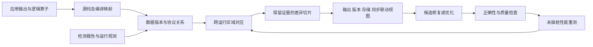

# 异步 GPU 算子可视诊断与优化：面向 TOG / VIS 的研究与实验规划

制定日期：2026-10-23。文档类型：研究规划与证据设计，不是已完成论文或实验报告。基线仓库：`fb2f5d2`。以下样本量、案例数、时间预算均为计划值；没有将其写成已取得结果。

## 1. 研究定位与投稿选择

建议题目：**基于数据版本与执行差分的异步 GPU 算子可视诊断与优化**。

英文工作标题：*Visual Diagnosis and Validated Optimization of Asynchronous GPU Kernels through Version-Aware Execution Comparison*。

研究对象是开发者实际使用的异步 GPU 算子及其图形应用。主问题是：当流水线、tile 布局或同步发生变化时，怎样把输出、逻辑数据、复用存储与异步协议对应起来，使开发者能够定位错误，并用真实重执行验证修复和性能改动？城市视图可以成为总览，论文的技术核心是执行对应、证据保留和诊断方法。

### 1.1 按贡献选择载体

| 目标 | 本研究应形成的主要论证 | 决定性证据 | 投稿身份与规则边界 |
| --- | --- | --- | --- |
| **ACM TOG / SIGGRAPH Journal track**，图形与交互系统路线 | 从图形输出到异步执行的新分析能力，支持实际图形程序中的诊断和优化 | 方法正确性、两个互补图形应用的深度案例、真实工作流与应用结果 | Journal track 发表 TOG；Conference track 是会议论文集。TOG 常规投稿程序另行核查，不能套用会议规则。[S1][S2] |
| **IEEE VIS / TVCG**，当前最自然的主线 | 面向并发执行的新数据抽象、差异表示和可检验诊断工作流 | 对应/切片质量、规模与成本、受控开发者任务及真实案例 | VIS full papers 发表 TVCG；2026 为 9 页内容加最多 2 页指定附属内容。用户研究不是所有论文的统一硬要求，但效率主张需要相应证据。[S3][S4] |
| **EuroVis / CGF**，相近可视分析路线 | 与 VIS 同一研究内核，强调分析任务、表示及领域有效性 | 领域需求、方法、定量分析和使用证据 | 2026 full papers 发表 CGF 特刊，正文 10 页、参考最多 2 页；后续届次必须重新核对规则。[S5] |
| **HPG / PACMCGIT**，性能方法路线 | 如果最强贡献变为低开销分析、优化选择或执行机制，围绕图形性能组织论文 | 未插桩应用时间、质量、工具成本、规模与机制消融 | 2026 HPG 录用论文发表 PACMCGIT，不是 TOG 或 CGF；2027 CFP 尚待核查。[S6] |

建议按 TOG 系统论文的完整证据准备，同时在技术先导后确定主投：图形应用的新能力和价值最强则选 TOG；跨执行分析与开发者诊断最强则选 VIS/TVCG。它们的贡献重心不同，不按“换个标题即可转投”设计。本文提出的案例数量和实验形式是本项目的研究建议，不是任何 venue 的录用规定。

截至本日期，SIGGRAPH 2027 官方页列出论文截止为 **2027-01-29 06:00（北京时间）**，但详细投稿说明仍待公布。当前到该日期约三个月，不应据此承诺完成本方案的全部证据；下一合适会议周期或期刊路线以完成度决定。[S2] 本文不把 2026 页数、匿名或轨道规则当作 2027 已确认要求。

## 2. 整体 motivation：从一个具体失败引出统一问题

### 2.1 面向论文引言的论证

现代图形计算包含神经场查询、图像重建、去噪和 Gaussian blending 等高吞吐算子。性能实现会把数据搬运、矩阵计算与结果消费组织成重叠流水线；逻辑数据被分块，同一片局部存储反复容纳不同版本，执行者通过完成令牌和同步协议交接所有权。这些交接错误可能表现为图像错误或帧时间回退，本研究聚焦这类问题；用户看到的输出、源码、编译后操作和运行事件具有不同身份。

例如一个循环复用的 SMEM stage：上一轮输入已到达，不代表所有计算消费者已经完成使用。新版本过早覆盖旧版本可能引发错误；反过来，保守地等待全部操作又可能消除原本合法的重叠。修改 stage 数或 tiling 后，动态事件数量和存储映射随之变化，逐时间点或逐指令比较难以说明究竟修复了什么、损失了什么。

已有检测器能够发现许多同步与内存错误，已有可视分析能够揭示等待原因，已有 trace diff 能比较多次运行。因此待解决的问题应限定为：**当逻辑工作保持可比而执行组织改变时，如何保留数据版本及协议证据的对应，使错误解释与性能改动可以核验？**

核心洞见是以**逻辑数据域和版本**作为跨执行的锚，以**异步协议义务**约束可折叠的证据，再把候选修复或优化交给完整重执行验证。这样，同一个表示可以承载“错误来自哪一轮数据”“修复增加了哪些必要顺序”“性能差异是否与该改动一致”等不同查询。

### 2.2 初始 motivating example

首例采用单 CTA、warp-specialized、两级/三级缓冲的 GEMM：TMA 将输入放入 SMEM，tcgen05 MMA 使用输入并写入 TMEM，epilogue 消费结果。准备四个程序版本：正确基线、提前复用的错误版本、过度串行化的正确修复、保留合法重叠的候选修复。最后一种是否更快由实测决定，不能预先保证。

应用层再把同一问题落实到可追溯的像素/特征输出。首例用于说明方法，不能独自承担 TOG 的应用证据。数值错误、模型允许的潜在竞态、无法判断的关系与测得的性能回退必须分别展示。

## 3. 相关工作的已解决问题与剩余任务

表中的“剩余任务”是本项目待验证的切口，不表示相关工作在所有情况下不能完成该任务；文献未展示不等于理论不支持。

| 最近邻 | 已解决什么 | 本研究必须进一步证明什么 |
| --- | --- | --- |
| Duca 2005，TOG；Hou 2009，TOG | 跨图形阶段关系查询、输出来源；GPU 内存数据流记录、错误回溯与可视化 | 现代复用缓冲及异步协议下，跨执行的逻辑数据域对应与证据保留；“点像素看来源”不单列为贡献。[R1] |
| Daisen 2021，CGF；Milestone 2026，VIS/TVCG 待刊 | 组件/任务/依赖探索，阻塞原因及跨层上下文；支持分析和验证优化机会 | 两次执行的组织改变后，怎样对应逻辑工作、区分不同解释并验证干预；“解释为什么等待”不是新主张。[R2][R3] |
| Compute Sanitizer、ConSan | TMEM guardrails、异步访问、barrier 与可见性等检查，具体能力依版本与配置 | 将已有检测结果接到数据版本、源码及修复差异；优先复用检测能力，不冒称全面超过现有工具。[R4][R5] |
| SentryWard，作者研究项目 | 支持范围内的 phase/HB、存储生命周期及同步删减验证，已有复用错误解释 | 重 tiling/流水线改变后的多对多对应，以及保留证据的差异抽取；phase 图、验证删除 wait 本身不新。[R6] |
| KPerfIR / Proton | 编译器内 profiling；现有工具支持跨 region 的异步事件身份 | 事件身份仍需与逻辑数据域及协议义务关联；不能声称首次配对异步起止。[R7] |
| HTA、TraceLens | 多次 trace 比较；TraceLens 支持层级结构对应及同一高层操作不同 leaf 的比较 | 对应进一步深入 kernel 内部的数据区域/版本，并保留异步协议的违例证据；不能声称首次语义 trace diff。[R8][R9] |
| Halide、Piko、Spire；Coz | 调度表达、优化选择、通过干预分析优化潜力 | 此处聚焦有证据的诊断与改动验证，不另做通用可视编程语言，也不把 what-if 视为新颖性。[R1][R10] |

与新近形式化/验证预印本 AI as a Compiler、RESOLVE、Racer 的能力矩阵需在第一阶段冻结版本后精读更新，避免首稿建立在过时空白上。[R11]

## 4. 研究问题与候选贡献：集中为三条

| 研究问题 | 候选技术贡献 | 必须建立的证据 |
| --- | --- | --- |
| RQ1：同一存储地址被复用、同一逻辑工作被重分块时，怎样可靠对应？ | **带版本和证据来源的跨层对应方法**：以逻辑坐标域及生产/消费版本建立区域关系，显式处理一对多、多对多、未匹配和不确定对应 | 小实例独立映射真值、跨 tiling/stage 改动的对应准确性与覆盖率；复杂度及规模实验 |
| RQ2：怎样压缩到能核验的解释，又不丢失决定性义务？ | **保留违例见证与未决义务的差异切片**：从输出/告警出发，保留冲突双方、存储代次、完成/可见性证据与相关执行变化 | 见证/证据保留检查；与全图、普通祖先切片和无版本切片比较；保留率、大小、时延和错误解释率 |
| RQ3：这种对应与切片能否支持有效修复和优化？ | **由证据驱动的交互诊断与重执行验证系统**：输出选择、版本追溯、差异比较及有限候选修改形成闭环 | 受控开发者任务、真实错误案例；修复通过保留验证，性能来自未插桩 kernel 与实际应用 |

RQ1/RQ2 是候选方法贡献，需通过最近邻复现与消融证明增量。RQ3 可以是充分验证的系统/交互贡献，不要求再发明通用优化器。若 RQ1/RQ2 最终仅是已有技术组合，必须转而证明集成带来的独特任务能力，或收缩论文主张。

第一篇不同时承诺：全 ISA 正确性证明、精确 Blackwell 周期仿真、任意 CUDA 自动转换、自动修复任意 bug、TPU 后端、自动探针选择或开放世界游戏学习效果。后续扩展不作为本篇验收依赖。

## 5. 整体框架与核心机制

### 5.1 输入及执行契约

首个前端选 Triton/Gluon，以便复用其异步操作表达、ConSan 与 Proton。源码标记/编译映射记录逻辑数据域及源位置；图形应用通过明确的算子接口接入。CUDA/CuTe 来源的图形 kernel 若需要移植，单列移植成本和语义/质量对照，不当作系统已经支持第二前端。

每次运行保留 `run_id`、源码/编译产物哈希、GPU、驱动、编译器、shape/stride、精度、输入身份、配置和采集能力。性能构建、插桩构建、验证构建分别标识。首个 SM100 实验限定 `cta_group::1`、单 CTA、2–3 stage、少量合法 layout；通过后扩展真实多 CTA grid，暂不引入跨 CTA 同步与 multicast。

### 5.2 版本与关系表示

| 实体/关系 | 所需信息及用途 |
| --- | --- |
| 逻辑数据 | 应用对象、tensor、坐标区域、语义迭代/归约域；分别记录规范要求的版本与实际观测/可推导的来源，后者不可知时标 unknown；不将 CTA 编号视为跨执行身份 |
| 物理存储 | allocation 身份、地址空间、区域、layout、复用代次；同地址可以有多个逻辑版本 |
| 执行操作 | 生产者/消费者、源/IR 位置、操作种类、读写域、所属 run |
| 协议义务 | 适用的完成、可见性、计数/代次、复用/释放条件及规则版本 |
| 证据 | 实机观测、编译映射、ISA 推导、受限模型、人工标签；保留原始事件指针和未观测范围 |

使用分类型关系图，分别存放数据来源、存储别名、ISA 建立的先后/可见性、观测等待和跨运行对应。它们不能混为一种“因果边”。barrier 记录完整逻辑代次，不仅记录循环重复的 parity；issue、completion、visibility、safe reuse 各有语义。

设备插桩点或 wait 返回时间不直接代表异步硬件真实开始/完成时间。缺失记录不代表没有同步。缺少规则或观测时返回 unknown；若支持模型枚举给出反例，则标为模型允许的违例，不自动称为实机已发生的错误。

### 5.3 跨运行对应算法的初始设计

1. 依据共同的预期算子规范与输入身份建立逻辑输出坐标域；被调试程序可以违反规范，不以它已经正确为配对前提。
2. 用区域交集建立操作/存储版本的候选对应。例如一个大 tile 与两个小 tile 对应，保存覆盖区域和比例，而不强迫一对一。
3. 结合预期的计算角色、逻辑迭代和归约域核验任务对应；将实际生产来源、消费版本及顺序作为被比较的对象。某消费任务本应读取 `A[k]` 却读取 `A[k+1]` 时，仍对应同一预期任务并标出来源差异，不能因版本错误而排除匹配。形状相同或名称相同不足以成立，无法确认的映射保留未匹配。
4. 在对应区域上比较协议义务、依赖、观测等待与性能结果，区分预期的组织变化和需解释的变化。

GEMM 的数值重关联可以改变舍入；Gaussian blending 的前后顺序可能改变语义。区域对应本身不证明数值等价，必须由独立数值/质量检查补充。初期只支持已定义映射规则的改动，静态索引到数据依赖地址的推广另列范围。

### 5.4 差异切片及保留条件

给定输出异常、检测器告警或性能回退的 seed，提取两侧相关区域及版本，再沿生产消费、存储复用和协议关系扩张。切片的终止条件应是相关义务已由证据封闭，或明确记录仍未解决的外部条件。

正确性切片至少保留：冲突双方与地址域、逻辑版本/分配代次、相关完成令牌与规则、必要的路径/同步信息和原始证据。若报告“缺少某种次序”，须有相应范围内的完整规则/观测支持；不能靠删掉边来制造缺失。

性能切片还必须考虑不在数据依赖祖先中的竞争者及资源释放事件。实机证据无法充分识别资源竞争时，报告可见差异并提出可检验假设，不输出唯一根因。第一版可以保留完整相关资源窗口，以保真优先；不声称得到全局最小解释。

需论证并测试的性质包括：区域覆盖的一致性、对应关系的类型正确性、切片对指定违例见证的保留，以及 unknown 在摘要中的传播。证明范围限定在定义好的关系模型，不替代 ISA 实现验证。

### 5.5 可视交互与实际改动

提供四个联动视图：图像/张量输出；逻辑版本到物理 stage 的占用；异步操作与协议义务；两次运行的对应与差异。颜色区分观测违例、模型反例、性能差异和未知，不把所有异常都画成确定错误。

支持的操作是选择输出、查询其来源、检查复用、比较修复前后、查看证据并触发重跑。修改范围从已有实现模板中的 stage 数、合法 tile/layout、wait 位置和 epilogue 分组开始。任何性能建议先生成可执行候选，经正确性检查后测量；保留失败、无收益与回退候选。通过有限测试的候选称为 tested-valid，不标为全域已证明安全。

## 6. 实际 apply：从算子到图形应用

### 6.1 算子层验证集

计划覆盖四个不同任务族：多阶段 GEMM；fused GEMM/MLP epilogue；attention 的搬运/矩阵计算/归约交接；图形 blending 或图像处理算子。首先落实前两项和一个图形核心，再决定是否加入完整 attention；不以增加任务名称替代实现深度。

每族选择整齐与非整除 shape、资源阈值两侧、不同迭代次数、合法 layout 和无收益配置。先固定一种输入/累加精度，再增加第二种；数值范围变化与性能规模变化分开设计。

### 6.2 两个 TOG 应用主案例

| 候选应用 | 为什么适合 | 输出到执行的锚 | 错误与优化任务 | 必须报告的限制 |
| --- | --- | --- | --- | --- |
| **GEMM-GS / 3D Gaussian Splatting 的 forward blending** | 作者方法把 blending 组织成 Tensor Core GEMM，代码包含双缓冲与异步复制，是真实图形算子 [A1] | view/frame、pixel、稳定 Gaussian ID；排序位置是需比较的顺序关系，不是身份 | 追踪异常像素涉及的数据版本；比较缓冲复用、分块与同步改动；验证渲染输出与帧时间 | 现有公开实现使用 `mma.sync`、`ldmatrix` 与 pipeline async copy，不是现成 tcgen05/TMA。SM100 移植是待做工作；先限定 forward，不承诺训练/梯度支持 |
| **Instant-NGP / tiny-cuda-nn 的神经场查询或 fused MLP** | 原系统使用融合 CUDA 神经网络，直接参与图形表示和渲染 [A2][A3] | 原始 ray ID、固定采样坐标/参数、层与 feature 域；压紧后的数组下标不作身份 | 检查融合层之间的布局/版本交接；比较阶段安排与 epilogue；观察误差如何影响输出图像 | 首先测 profile，确认待研究 kernel 在实际路径及其占比；小网络可能不适合 tcgen05，不能预设迁移有收益 |

若第二案例的移植和观测成本不合适，可在第一阶段选择 **Open Image Denoise** 的实际卷积/融合层作为替代。它是开源的光线追踪图像去噪库并支持 NVIDIA GPU，但其当前具体 kernel、指令路径和可替换接口仍需代码审查；不把库支持 Blackwell 写成其必然使用 tcgen05。[A4]

上述候选是应用入口，不是已发现错误的项目名单。每个主应用目标选 2 个开发场景和至少 6 个保留场景/图像，按完整场景分割；帧是重复观测，不当作独立场景。固定相机、checkpoint、分辨率、精度和渲染设置；若改变近似、排序或剪枝，则单列质量—性能比较。

神经场首阶段固定采样集合。后续加入 compaction、剔除或 early termination 时，明确记录新增/消失的逻辑工作；不能为提高匹配率，把不同采样点或不同 Gaussian 强行对应。

### 6.3 三个论文叙事案例

- **错误可视化：**从错误输出区域进入，识别两次访问指向同一物理 stage 的不同版本，展示违例证据并核验修复。
- **正确但变慢的修复：**同样正确的两个修复产生不同重叠与资源占用；通过配对运行分析差异，用未插桩实测评价代价。
- **优化的适用范围：**一个修改在部分 shape/场景上有效，在另一些无收益或退化；利用差异证据解释边界，并在保留配置验证。

同一框架必须实际完成至少前两个闭环。城市动画、代码截图或优化后的单一数字不能替代输出→证据→改动→结果的记录。

## 7. 实验基础设施与数据划分

### 7.1 硬件与可复现身份

最低实机条件是一张可稳定重复运行的 SM100/B200 级设备，具备编译、sanitizer、profiler 权限及足够的独占测量窗口。不能用 SM120/RTX 5090 替代 tcgen05/TMEM 实验。第二 GPU 若加入，仅在共同支持子集评估可迁移性，不强求同一 ISA 路径。

记录 GPU/CPU/内存、OS、驱动/CUDA、Triton/Gluon、检测器、profiler、编译参数与 commit；记录时钟/温度/并发负载状态。应用、输入、版本、变更、测试结果和时间样本通过 manifest 关联。现有 trace 来源与回放基础可复用，教学模型与 FlashGPU-Sim vectorAdd 不充当 SM100 真实性证据。

### 7.2 Ground truth 与案例规模

| 数据集 | 规划规模及分母 | 独立判定方法 |
| --- | --- | --- |
| 语义微程序 | 先构造 20–30 组正确/错误协议对照；规模依支持子集调整 | 公开 ISA 规则、小状态枚举和两名独立审查者；不由系统自己的 ID 生成器给自己打分 |
| 错误案例库 | 目标 24–40 个独立根因；其中争取 6–12 个真实公开/开发错误，其余为明确注入 | 原项目版本、复现、修复和根因记录；数值检查及规则审计；数量达不到时据实收缩 |
| 合法复杂对照 | 20–30 个并发/复用/不同合法等待方式的程序配置 | reference 与协议核查；不只用完全串行代码测误报 |
| 算子性能与对应集 | 每已实现任务族先规划 8–12 个 shape/stage/layout 配置，保留整类未见改动 | 独立坐标枚举、数值 reference、完整重执行；实际数量随支持范围冻结 |
| 图形应用 | 两个主应用，各 2 个开发场景及至少 6 个保留场景/图像 | 固定 checkpoint/输入与质量标准，实际 kernel 及端到端测量 |

错误类型覆盖 barrier 代次/计数、适用的可见性规则、SMEM/TMEM 提前复用/释放、descriptor/layout 错配。一个变异模板在不同 seed/shape 上重复仍算同一根因；每个根因可带 3–10 个触发实例，但分开计数。真实错误与注入错误分别统计，开发集与保留集按程序家族/根因拆分。

数值 reference 先将输入舍入到目标输入格式，再用更高精度独立计算；按算法、精度与归约长度预先确定容差。报告最大绝对误差、相对范数误差、超容差元素比例及 NaN/Inf。sanitizer 是辅助证据，不是唯一真值；超时不直接等于已证明死锁。

## 8. 定量指标、基线与消融

### 8.1 核心实验矩阵

| ID / 主张 | 核心指标与定义 | 对照与实验单位 |
| --- | --- | --- |
| E1 对应正确性 | `precision=正确输出关系/全部输出关系`；`recall=找回真值关系/全部真值关系`；另报覆盖率、未知率和错误确信率 | 名称/源码位置对应、区域对应、完整版本/协议对应；一对一与多对多分别报告，按任务家族汇总 |
| E2 证据切片保真 | `见证保留率=保留有效违例见证的案例/有独立见证的可支持案例`；`证据保留率=保留必需证据/独立标注必需证据`；节点/边/字节保留比例 | 全图、普通依赖祖先切片、无版本/无外部竞争切片、完整方法；未知边界不得消失 |
| E3 检测与诊断 | 错误/合法程序上的覆盖、recall、误报分别报告；根因及版本/义务解释由盲审 rubric 判定 | Compute Sanitizer、ConSan、适用的 SentryWard；共同支持子集与完整 corpus 都报告。复用同一 detector 时不主张新增检测能力 |
| E4 开发者主要终点 | **时限内通过保留验证的修复比例**；诊断正确率、无效修改次数、删失修复时间为次要 | 强工具工作流 vs 新系统；相同底层信息的表示消融；统计单位为参与者与任务，见第 9 节 |
| E5 改动验证与优化 | `S_kernel=T_base/T_new`；`S_app=T_base_app/T_new_app`；保留配置的通过率、失败率和回退 | 原始优化实现、库/作者推荐实现、系统辅助得到的候选；固定精度/质量与完整可替换边界 |
| E6 优化选择（若声称） | `regret=T_selected/T_best_tested-1`，best 限于相同合法候选集合；同测量预算下的失败与开销 | 经验规则、随机或常规调参、系统辅助；不能用看过全部结果的解释器冒充预算内选优 |
| E7 成本与规模 | 采集慢化比 `T_instrumented/T_original`、日志 bytes、构图/对应/切片时间、内存、冷/热查询 p50/p95 | 相同事件/launch 范围；从局部 ROI 到全 kernel，逐级扩大事件数及版本复用深度 |
| E8 图形质量与外推 | PSNR/SSIM、固定误差阈值的异常像素比例及最大误差；kernel 占比与端到端收益；保留场景结果 | 固定 reference、动态范围和视角；质量/性能配对，有限测试不等于全域正确 |

E1 的区域关系评价同时提供按逻辑元素覆盖计算的结果，避免一对多关系被任意拆边后改变分数。E2 不强求只有唯一正确切片：可保留任一足以核验同一违例的有效见证，独立审查其充分性；不能因删得更小就视为更好。

### 8.2 强基线与控制比较

1. **现实工作流基线：**锁定版本的 Compute Sanitizer/ConSan、Proton/Nsight、源码与常用脚本。给予合理配置和熟悉时间；不以 printf 或单张静态截图作为唯一基线。
2. **表示/交互控制：**保持相同 detector、字段、源码、原始事件及查询权限，比较基础关联视图与版本/差异切片。它用于隔离呈现/分析组织的贡献。
3. **对应方法基线：**HTA/TraceLens 用于其支持的 kernel/高层范围；kernel 内部另设名称/位置、区域和版本对应消融。不能把高层工具未支持内部配对当作其错误答案。
4. **可视分析近邻：**尽可能使用 Daisen/Milestone 的公开实现及兼容数据；若只有可重建视图，明确写作“受其启发的匹配视图”，不能冒称精确复现原系统。它们不是 SM100 正确性 oracle。
5. **方法消融：**去版本、去跨运行对应、去义务封闭、去竞争上下文分别回答必要问题；其中不适用的消融不强做。不要仅用“完整系统 vs 什么都没有”归因所有机制。

每个工具明确 supported/unsupported/timeout/tool failure，缺失不填零；列出完整集合、支持交集和被排除原因。工具链与任务选择应在正式保留集评估前冻结。

### 8.3 性能测量与统计

未插桩生产构建测 kernel 与应用性能；验证和 profiler 另跑。设备时间采用适当设备计时，端到端保持真实同步方式，分别报告 JIT/编译、布局转换、数据搬运、dispatch 和执行边界。

先预热并检查稳定性，正式测量可从 30 个随机 AB/BA 成对测量块起步，每块重复量依据量化误差与先导方差确定；这是初始预算而非所有工作负载的固定充分样本数。保存原始时间，按预定规则处理漂移，报告逐配置效应与 95% CI。

跨配置 speedup 可报几何均值，并保留全部逐项数据；有代表工作负载权重时另报加权总时间。错误/对应统计按程序家族或根因做 cluster bootstrap；不能把数百次同一 bug 运行当数百个独立案例。图形帧在场景内聚合。多重推断采用预先确定的校正，主要终点以效应量和区间解释。

性能根因需要独立机制证据和受控改动支持。第一次差异、最大等待占比、计数器相关性均不自动等于原因。若修改同时影响寄存器、占用和指令调度，先报告整个修改的效果，进一步控制才能分离因素。没有性能预测器时不增加预测准确率主张。

## 9. 开发者研究：评价实际诊断能力

先做 4–6 名 CUDA/Triton/CuTe 开发者的形成性研究，调查真实任务、试运行培训和题目，形成任务抽象及设计依据。先导人员和数据不混入正式效果估计。

主研究暂按 **18–24 名开发者、每人 6 个匹配任务、两条件各 3 个、每题最多 12–15 分钟**估算资源，任务从覆盖多个独立根因的冻结任务池分配。这不是 power analysis；先导后根据最小有意义效果、参与者及任务变异进行模拟，确定并冻结最终样本量。若无法获得足够样本，报告精度有限的研究，不凭方便人数声称已充分验证效率。

主要任务研究比较强工具工作流和新系统，允许实际编辑/重跑，并提供相同的公开开发测试及 reference 接口。另设冻结的隐藏评估集，仅在最终提交或任务结束后检查，不把隐藏用例逐轮反馈给参与者。次要的首次合格候选时间可离线核查带时间戳的候选历史，与最终提交成功率分别报告。任务族分配、条件顺序和难度平衡；同一人不在另一条件重做同根因变体，避免答案记忆。研究预算包括公共编译/运行成本，各条件等待条件一致。

**主要终点为时限内最终提交的版本通过隐藏保留验证。** 使用参与者与任务随机效应的 logistic 模型估计差异；任务超时、放弃和失败保留在分母。统一时限造成的未完成可作为行政右删失；主动放弃或已知失败不能在退出时刻直接当作非信息性删失，应预先定义为时限内未成功，并在时间代价指标中按时限计入，或采用明确的竞争结局模型。不只比较成功者平均时间。解释由不知道条件的独立评审依据根因、版本、义务和证据四项评分，并报告一致性。

两条件的整套工作流比较支持系统整体效果，不能单独证明某种视觉编码贡献。若需要后者，另做相同信息/分析结果的匹配表示研究；不把两种实验混在一个含糊的“用户研究”结论里。优化选择可作探索性任务或独立研究，避免六题同时检验过多主张。

主观负担、信心与偏好仅作补充。采用所在机构适用的批准/豁免、同意及数据处理流程，按照目标 venue 报告；不需要在规划阶段向参与者发送任何消息。

## 10. 按论文结构组织，而不是按功能清单写

### 10.1 TOG / SIGGRAPH Journal 的建议结构

| 章节 | 论证任务 | 计划证据/图表 |
| --- | --- | --- |
| Abstract | 问题、核心洞见、方法和最终取得的决定性结果 | 研究完成后填真实数字；现阶段不写成功式摘要 |
| 1 Introduction | 图形算子异步交接的代价、最近邻及三条贡献 | 一张真实应用症状→数据版本→修复的 teaser |
| 2 Background and Related Work | 必要协议语义与最近邻比较轴 | 能力/证据范围表，不使用无依据的功能勾叉 |
| 3 Problem and Design Requirements | 任务、支持子集、跨运行对应对象和不变量 | motivating example；必要的领域需求依据 |
| 4 Version-Aware Correspondence | 区域、版本、映射算法及其范围/成本 | 一对多实例、伪代码和关键性质 |
| 5 Evidence-Preserving Differential Analysis | 切片规则、义务封闭、未知与竞争边界 | 正确/错误切片对照及保留条件 |
| 6 Interactive System and Integration | 四视图联动、候选修改、实际重跑和应用接口 | 操作示例与 implementation/capability 表 |
| 7 Evaluation | 按 E1/E2、成本、任务效果、真实应用结果回答主张 | 对应/切片、规模、开发者、质量—性能及消融图 |
| 8 Discussion and Limitations | 可观测性、近似/顺序、采集扰动、推广条件与失败案例 | 真实限制、无法配对和无收益案例 |
| 9 Conclusion | 回答研究问题，明确被验证范围 | 不增加正文没有证明的自动化或跨 DSA 声称 |

建议先写约 10–12 页正文的论证草稿作为内部预算，并按选定年度/轨道实际规则调整；这不是 TOG 页数规定。方法和关键验证留主文，完整案例、参数、协议、原始样本和附加场景放补充材料。

### 10.2 VIS / TVCG 的结构调整

若主投 VIS，把领域需求与任务抽象提前，并将可视编码、交互选择及设计理由作为主要方法内容；突出与 Daisen/Milestone 的任务差异。按 2026 的 9 页内容预算，可初分：引言/相关工作 1.5 页、任务与抽象 1 页、方法与交互 3 页、实现 0.5 页、评价 2.5 页、讨论/结论 0.5 页。实际 2027/后续规则另核对。[S3]

两种结构使用同一证据集，但 TOG 版本强调图形程序新能力和图形应用中的完整价值，VIS 版本强调分析表示、推理过程和诊断证据。若主要新增是可扩展性能机制，则依据 HPG 的正式规则重构主张和实验顺序。

### 10.3 最小图表清单

计划形成 8 组决定性图表：真实应用 teaser；框架/语义关系；重分块对应实例；完整证据与切片；准确性/覆盖率/消融；规模与采集成本；开发者修复结果；逐场景质量与 kernel/应用性能。图像误差图使用固定尺度和真实输出，轨迹图标明 run 与证据来源。动画视频辅助展示操作，主文仍能独立判断贡献。

## 11. 实施顺序、资源估算与继续条件

在有稳定 B200 访问、约两名能投入实现/研究的人及领域评审支持时，可按 **6–9 个月**估算完整研究资源；不承诺单人或硬件不足时同样进度。下列 26 周安排是工作拆分草案，不是实验成功预测。

| 阶段 | 工作与可审查产物 | 继续条件 |
| --- | --- | --- |
| W1–2：范围与新颖性先导 | 固定前端/ISA/工具版本；运行最近邻；审计图形入口；选择真实错误和数值 reference | 确认硬件与可观测证据；至少一个最近邻不能直接完成的具体对应/诊断任务 |
| W3–6：语义与采集 | 单 CTA 正确/错误/修复三版本；逻辑区域、存储版本与协议关联；能力声明 | 独立核对关键对应，未知不伪装确定关系；至少一个真实 kernel 闭环 |
| W7–10：对应与切片 | 一对多区域对应、保留条件、差异分析及消融 | 已知支持案例的违例见证不丢失；明确优于简单对应/祖先切片的任务实例 |
| W11–14：应用接入 | 完整 grid；两个图形候选中完成主案例，冻结最终应用选择 | 实际调用路径及输出可关联；端到端数值/质量检查；移植收益或代价有实测 |
| W15–18：定量技术评价 | 冻结保留集、案例 manifest、性能与成本、失败案例 | 指标分母/覆盖明确，可重现；无未解决的关键误配或伪造因果关系 |
| W19–22：开发者评价 | 先导、样本量设计、正式研究及盲评分；可与技术阶段部分并行 | 主张对应效果及不确定性，按预定规则报告超时和无效修复 |
| W23–26：稿件与独立复核 | 按主投 venue 重写故事；复核 artifact、图表、视频和最近文献 | 每条主张都有独立证据，关键方法与验证在主文成立 |

**研究转向条件：**没有 kernel 内部可靠对应，就先收缩固定 tiling；没有保真的切片，就保留完整相关证据而不宣称压缩方法；没有图形应用新能力，就选择通用可视分析定位；没有未插桩应用收益，就删除图形性能提升主张；只有注入故障，就明确限定为受控故障研究。任何转向都应更新标题、贡献和实验分母。

提交前的最低证据应包括：可复现的支持范围；与强近邻的实质区别；对应与切片的独立验证；实际应用/任务价值；完整成本及失败报告。没有预设“达到某个加速比或用户人数就能录用”的阈值。

## 12. 规划结论

建议将第一篇论文收敛为**以逻辑数据版本为锚的跨执行对应与证据保留方法，并应用于异步 GPU 算子的错误诊断和改动验证**。统一框架能够提出有检验方式的三条主张：对应可靠、解释保真、开发者/应用获得实际价值；每条都有独立实验，不靠功能数量或视觉效果代替。

TOG 路线应由真实图形程序中的新能力和结果支撑；VIS/TVCG 路线与当前可视分析重心更自然。先完成六周技术先导，验证一个真实算子的错误→解释→修复→重测闭环，再决定是否投入两个图形应用和完整开发者研究。DSA 泛化、调度游戏与主动探针选择保留为后续工作。

最终论文结论只能在实验完成后写成：在明确的算子、改动、设备与观测范围内，某种对应/切片机制带来哪些经比较验证的收益及代价。现阶段能确定的是可执行的研究路线与证据需求，不能预写成功结果或保证录用。

## 来源与政策核查

- [S1] [SIGGRAPH 2026 Technical Papers](https://s2026.siggraph.org/program/technical-papers/)；[审稿说明](https://s2026.siggraph.org/technical-papers-reviewer-instructions-ethics/)。系统集成、实验研究等也是合法贡献形态，并非每篇必须新算法或用户研究。
- [S2] [SIGGRAPH 2027 Technical Papers](https://s2027.siggraph.org/program/technical-papers/)。截至本日期日期已列出，详细规则待公布；TOG 常规作者指南此次未成功读取，不声称核实其完整程序。
- [S3] [IEEE VIS 2026 submission guidelines](https://ieeevis.org/year/2026/info/call-participation/paper-submission-guidelines/)。
- [S4] [IEEE VIS 2026 review instructions](https://ieeevis.org/year/2026/info/call-participation/review-instructions/)。
- [S5] [EuroVis 2026 author guidelines](https://eurovis.org.uk/author-guidelines/)。该届还对生成式 AI 科学内容/正文作出限制；本文件是规划，不作为可直接提交的正文，后续选择该 venue 时重新核对相应届次规则。
- [S6] [HPG 2026 call for participation](https://highperformancegraphics.org/2026/call-for-participation/)。
- [R1] [TOG 直接近邻及一手来源汇总](tog-publication-assessment.md)。
- [R2] [Daisen 作者页面](https://vis.khoury.northeastern.edu/pubs/Sun2021DaisenFrameworkVisualizing/)。
- [R3] [Milestone 作者原文](https://sarchlab.org/vis_the_invisible.pdf)。
- [R4] [Compute Sanitizer](https://docs.nvidia.com/compute-sanitizer/ComputeSanitizer/index.html)。
- [R5] [ConSan 设计](https://github.com/triton-lang/triton/blob/main/include/triton/Dialect/TritonInstrument/IR/TritonInstrument.md)。
- [R6] [SentryWard 作者说明](https://sentryward.io/blog/)。
- [R7] [KPerfIR / OSDI 2025](https://www.usenix.org/conference/osdi25/presentation/guan)；[Proton 异步事件](https://triton-lang.org/main/dialects/ProtonOps.html)。
- [R8] [HTA Trace Diff](https://docs.pytorch.org/tutorials/beginner/hta_trace_diff_tutorial.html)。
- [R9] [TraceLens Trace Comparison](https://github.com/AMD-AGI/TraceLens/blob/main/docs/how-to/compare-traces.md)。
- [R10] [Coz 作者项目](https://github.com/plasma-umass/coz)。
- [R11] [现代 GPU 调试近邻与预印本核查](async-accelerator-debugging.md)。
- [A1] [GEMM-GS 作者论文](https://arxiv.org/abs/2604.02120)；[作者实现](https://github.com/shieldforever/GEMM-GS)；[forward kernel](https://github.com/shieldforever/GEMM-GS/blob/main/submodules/gemm-gs/cuda_rasterizer/forward.cu)。
- [A2] [Instant Neural Graphics Primitives，TOG 2022](https://nvlabs.github.io/instant-ngp/)。
- [A3] [tiny-cuda-nn 作者实现](https://github.com/NVlabs/tiny-cuda-nn)。
- [A4] [Open Image Denoise](https://www.openimagedenoise.org/)。
