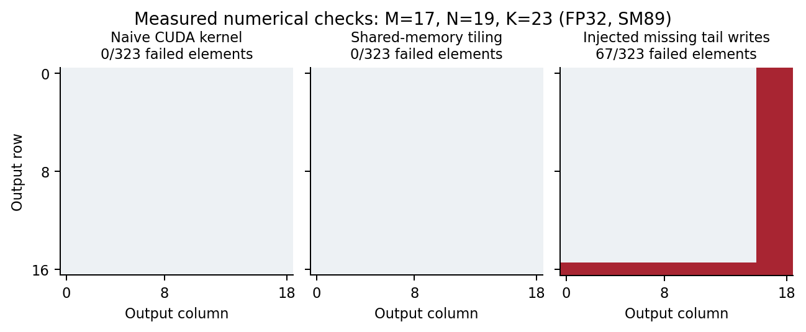
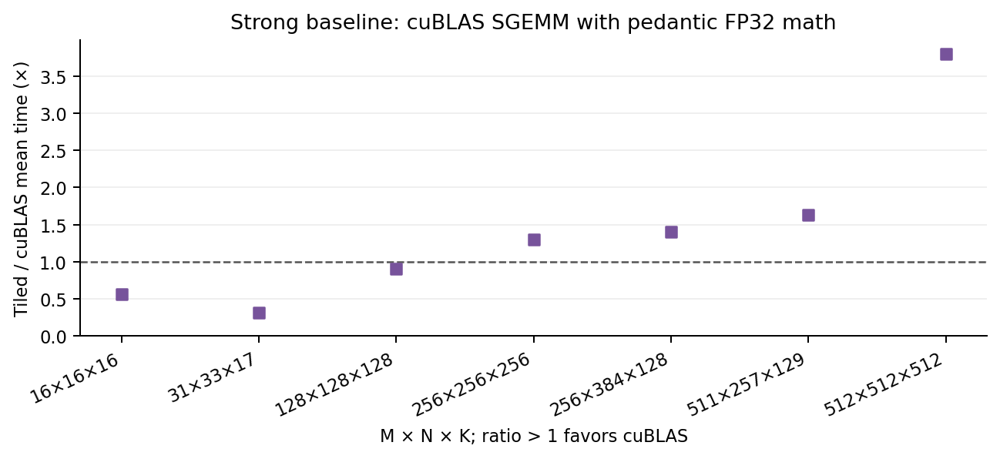

# GPU 研究实验记录：模型方法与 SM89 实机先导

日期：2026-10-23。对应[整体研究规划](../../async-gpu-paper-plan.md)。这是实际执行记录，不是已完成全部投稿实验的报告。本页数字来自独立模型实验和本机 CUDA 实验；随后按用户指定完成的 `/home/liuwei/GPU-simulator` 多卡 trace 复用见[后续报告](../2026-10-23-multigpu/report.md)。

## 1. 当前结果与证据范围

已经实现并运行：带预期版本的区域对应、保留给定诊断见证的切片、独立坐标枚举 oracle、方法对照及规模实验；在 RTX 4090 上执行了 GEMM 正确性、故障注入、profiling、分块优化、cuBLAS 对照和两层 MLP 计算块验证。可复现入口见[模型实验说明](../../../../tools/research/README.md)与[CUDA 实验说明](../../../../tools/research/cuda/README.md)。

**模型实验与实机算子实验目前是两条独立证据链。** 模型图中的逻辑映射和诊断义务由实验契约给定；尚未从真实 GPU 指令自动恢复版本/协议图。实机性能收益来自对算子实现的修改，没有经过人类可视分析实验，不能归因于所提界面。没有人类参与者，也没有独立理解收益结果。

| 规划指标 | 本轮取得的证据 | 尚不能宣称 |
| --- | --- | --- |
| E1 对应 | 26 个开发期合成案例，独立原子枚举；另有规模对照 | 真实编译映射正确、任意重 tiling/归约等价 |
| E2 切片 | 6 个合成案例中，5 个具有给定诊断见证；检查实体、状态和 unknown 保留 | 新检测器、真实 ISA 违例自动判定 |
| E3 检测/诊断 | 真实 CUDA 数值检查及 4 类 sanitizer 的一个故障模板对照 | 超过 ConSan、覆盖 TMA/tcgen05 或发现真实项目 bug |
| E4 修复工作流 | 准备了正确、故障、改进候选 | 人类修复率/速度、AI 自然错误率 |
| E5 优化 | 7 个 GEMM 计时配置、严格 FP32 cuBLAS 参照、3 个 MLP batch | 完整模型/请求加速、已完成真实项目算子替换 |
| E6 预算内选优 | 未执行 | 自动优化策略效果 |
| E7 成本 | CPU 方法时间、两种几何分布、16–1024 节点/run | 实机插桩成本、冷查询或大型真实 trace 的全面可扩展性 |
| E8 图形 | 本轮未执行 | 图形质量/帧率结论 |
| E9/E10/E11 人与 AI | 未采集真实参与者/固定 AI 候选评价 | 独立理解、信心校准或解释正确性改善 |

## 2. 环境、身份与可复现性

实机报告为 NVIDIA GeForce RTX 4090，SM89、128 SM、L2 75,497,472 bytes；驱动报告显存 49,140 MiB，记录实际返回值，不套用零售型号容量。驱动 610.57.04，编译/runtime 为 CUDA 12.6，cuBLAS 12.6.0；Nsight Compute 与 Compute Sanitizer 2025.4.1，Nsight Systems 2024.6.2。这里没有执行 SM100/TMA/tcgen05/TMEM。

GPU 是共享机器上的空闲窗口。每阶段检查利用率、可用显存和其他 CUDA 进程，连续满足守卫条件才继续；不终止其他作业、不改频率。阶段间检查不能排除短暂并发，因此这些是先导测量，不是独占多会话正式评估。CPU 方法时间同样没有绑核或锁频。

最终模型 run：`2026-10-23T07-37-00-998Z`；核心源码 SHA256：`68a811f9ed0480758f77fdfbc26b34716cd017d5a3bdac5d4ca7d0f3edacd630`。本轮基线 git HEAD 是 `3731659`；新代码当时尚未提交，manifest 同时保存开始/结束源码哈希，不能仅用该旧 HEAD 复现。源码快照、输入、原始样本及失败记录随本目录保存。

## 3. E1：声明逻辑映射上的对应

26 个案例包括 14 个手写契约案例和 12 个固定 seed 的网格变体；不是 26 个真实 GPU bug，也不是冻结外部保留集。覆盖一对多、多对多、半开边界、尾块、角色/迭代/归约区分、身份不相容、重复代次，以及实际读取错误版本/来源未知。

独立 oracle 逐整数坐标枚举，生产实现计算矩形交集。微平均的单位是去重的 `(left node, right node, coordinate)` 关系；空分母为 null。

| 对应方法 | Precision | Recall |
| --- | ---: | ---: |
| 源码锚＋区域约束 | 0.8616 | 0.9716 |
| 仅同 tensor 区域 | 0.8150 | 1.0000 |
| 预期语义约束＋区域 | 1.0000 | 1.0000 |

完整语义方法的扫描、固定轴和自适应轴三种实现均与 oracle 一致。错误的实际来源仍对应预期任务，再标记来源差异；unknown 不当作相等。结果支持当前有限契约的实现正确性，**不验证契约/映射从真实程序提取的正确性，也不建立论文新颖性**。[逐案例结果](model/results.json)

## 4. E2：给定见证的保留

| 方法 | 完整见证保留 | 必需证据保留比例 | 节点保留比例中位数 |
| --- | ---: | ---: | ---: |
| 完整图 | 5/5 | 1.000 | 1.000 |
| 仅数据祖先 | 1/5 | 0.500 | 0.400 |
| 证据闭包切片 | 5/5 | 1.000 | 0.800 |

第六个无诊断对照不进入见证分母。保留标准同时检查冲突节点、边、义务、原有状态、正证据记录与 unknown 边界。给定的 `violated/satisfied/unknown` 是输入，程序没有据此发现新违例。当前小案例中压缩幅度有限，不能据 5/5 宣称真实错误库上的保真率。[完整方法报告](model/report.md)

## 5. E7：性能问题、负结果及修复

初版组内逐对扫描随节点数增长。第一次固定首轴索引在首轴全部重叠的输入上没有收益，结果和当时准确匹配哈希的源码保存在[负结果归档](fixed-axis-negative/report.md)。随后增加常规的按组选择坐标轴，保留固定轴消融与两种输入分布；这是一项工程优化，不作为新算法贡献。

最终同轮测量，每侧 1024 个节点，5 次预热、30 次计时，方法顺序打乱：

| 分布 | 扫描中位 ms | 固定首轴中位 ms | 自适应轴中位 ms / p95 |
| --- | ---: | ---: | ---: |
| 首轴分离 | 41.113 | 1.327 | 1.324 / 1.745 |
| 首轴全部重叠 | 38.217 | 38.854 | 1.345 / 2.214 |

这些是包含校验、分配的 CPU 函数调用时间，排除 oracle、JSON 序列化和文件 I/O；不是 GPU 时间。输入已在内存且经过预热。最坏情况下仍可能逐对检查；两种有限网格分布不能证明一般可扩展性。完整逐规模结果、原始样本和分母见[模型结果](model/results.json)。

独立代码审查还发现并修复两项边界问题：再次切片会丢失原始外部边界，因此要求回到完整父运行；对 150,000 个候选展开函数参数会超过 JavaScript 上限，已改为循环并加零输出大输入回归。这些是工程缺陷修复，不是 GPU 违例发现。

## 6. 实机正确性与错误可视化

算子为连续行主序 FP32 GEMM。CPU 参考使用实际 FP32 输入，以 double 乘法和累加独立计算；预先设定 `atol=2e-5, rtol=2e-4`，任何 NaN/Inf 均失败。12 个 shape、2 个 seed：

| 候选 | 数值通过 | 数值失败 | 解释 |
| --- | ---: | ---: | --- |
| 朴素 CUDA | 24/24 | 0 | 有边界保护的逐输出点积 |
| 16×16 SMEM 分块 | 24/24 | 0 | 常规同步共享内存复用 |
| 实验注入尾块故障 | 12/24 | 12/24 | 漏写不完整输出块；整齐 shape 不暴露该故障 |

独立 cuBLAS 对照中，tiled 与 cuBLAS 也各通过 24/24；它们是另一运行中的重复验证，不算新的独立任务。一个故障模板在多个 shape/seed 上触发，仍只算一个注入根因。旧主运行 metadata 中 `human-specified` 是措辞错误：具体尾块故障由本次实验设计指定，非用户提供的真实故障。原始记录保留，未改写历史。

在 `M=17,N=19,K=23`、固定 seed 下，故障有 67/323 个未写元素，保留初始化的 NaN 哨兵。下面是实测输出检查图，红色表示数值失败，不表示错误幅度或内存竞态。



在 `31×33×17` 上，memcheck/racecheck/initcheck/synccheck 对三个候选都报告零工具检测错误；故障程序仍因数值失败返回 exit 2。它说明**该次合法地址范围内的语义漏写需要独立数值核验**，不说明这些工具普遍无法发现数值相关问题。[数值原始记录](cuda/main.json) · [工具摘要](cuda/profiles.json)

## 7. 实机优化、强参照与局限

先做正确性，再运行 Nsight Systems，然后针对 512³ kernel 做 NCU。基线 DRAM 峰值吞吐占比约 2.99%，LSU 指令吞吐约 90.33%，L1TEX 吞吐约 93.49%；分块后分别约 3.88%、85.74%、88.99%，并增加 barrier 等待。这支持减少重复加载请求的优化假设，不证明唯一瓶颈或单独因素的因果效果。Profiler replay 的约 69.856/53.792 µs 不用于计算生产加速。

未插桩原生计时：每候选预热 30 次，30 个平衡随机 AB/BA 成对块，每块 30 次 launch。输入反复驻留，CUDA-event 区间除以 launch 数；包含可能的 host dispatch/设备队列空隙，不等于纯 kernel-body 时间，也不含传输、初始化、编译。比值为**配对样本均值之比**，不是下表中位数之比；95% 区间为固定 seed、2000 次成对 bootstrap，只描述这一次会话。

| M×N×K | 朴素中位 µs | tiled 中位 µs | 朴素/tiled 均值比 [95% CI] |
| --- | ---: | ---: | ---: |
| 16×16×16 | 2.014 | 2.044 | 1.001 [0.980, 1.025] |
| 31×33×17 | 2.007 | 2.048 | 1.084 [0.961, 1.322] |
| 128×128×128 | 4.369 | 3.959 | 1.105 [1.103, 1.108] |
| 256×256×256 | 8.499 | 8.465 | 0.995 [0.975, 1.006] |
| 256×384×128 | 7.465 | 6.383 | 1.172 [1.169, 1.175] |
| 511×257×129 | 10.684 | 9.743 | 1.097 [1.095, 1.099] |
| 512×512×512 | 57.994 | 45.571 | 1.2730 [1.2726, 1.2734] |

`31×33×17` 存在较大计时样本，区间包含 1，不能将其均值比当作明确收益；`256³` 同样无明确收益。保留全部样本，未因不利结果删掉配置。

另一次独立测量使用 `CUBLAS_PEDANTIC_MATH` 和 `CUBLAS_ATOMICS_NOT_ALLOWED` 的 SGEMM，避免 TF32 混比。下面大于 1 表示 cuBLAS 更快；不能把两次测量的比值相乘得到未经实测的朴素/cuBLAS 对比。

| M×N×K | tiled 中位 µs | cuBLAS 中位 µs | tiled/cuBLAS 均值比 [95% CI] |
| --- | ---: | ---: | ---: |
| 16×16×16 | 2.065 | 3.579 | 0.564 [0.537, 0.582] |
| 31×33×17 | 2.083 | 6.690 | 0.313 [0.309, 0.316] |
| 128×128×128 | 3.959 | 4.394 | 0.902 [0.901, 0.904] |
| 256×256×256 | 8.465 | 6.518 | 1.300 [1.298, 1.302] |
| 256×384×128 | 6.383 | 4.540 | 1.406 [1.402, 1.410] |
| 511×257×129 | 9.821 | 6.007 | 1.632 [1.628, 1.634] |
| 512×512×512 | 45.602 | 12.008 | 3.794 [3.778, 3.807] |

较小配置受到库调用/dispatch 等因素影响，其结果不能证明自行实现的算术 kernel 更强。512³ 的结果则明确显示相对成熟库仍有明显差距。[全部配对数据](cuda/cublas.json)



## 8. AI 计算块集成

执行无 bias、未融合的 `ReLU(XW1)W2`，维度 `(batch,input,hidden,output)` 为 `(16/64/128,128,256,128)`。CPU 参考在第一层 double 计算后显式舍入到 FP32，再 ReLU 和第二层 double 计算；预设 `atol=rtol=3e-4`。3 batch×2 seed×3 候选共 18/18 通过，最大绝对误差约 `5.76e-5`。

| batch | 朴素/tiled 块时间均值比 | tiled/cuBLAS 块时间均值比 |
| --- | ---: | ---: |
| 16 | 1.102 | 1.391 |
| 64 | 1.106 | 0.899 |
| 128 | 1.092 | 0.955 |

比值来自各自配对实验，完整区间与 180 对样本在 [MLP 数据](cuda/mlp.json)。计时包含两个 GEMM 和 ReLU，但不含输入搬运/分配或完整请求。该块由本实验实现，**尚未接入已有真实模型的调用路径**，不能将其视为完成规划 §6.2 的真实模型算子替换。三个实机运行合计保存 600 对时间样本，不是 600 个独立工作负载。

## 9. 负结果、失败与未完成条件

- 固定轴索引在不利分布下无收益，原始结果及源快照单独保留。
- GPU 外部作业及滞后利用率触发了停止，停止记录不计作成功实验；初次 Nsight 采集遇到共享临时目录权限问题，后改为 run-local TMPDIR。[停止记录](cuda/stopped-attempts.json)
- 边界检查通过和 sanitizer 无告警不替代数值正确性；朴素到 tiled 的提升不等于超过成熟库；单 kernel 收益不等于应用收益。
- 尚需真实 trace/编译映射接入、现代异步协议依据、真实错误与合法复杂程序、固定 AI 候选及解释语料、匹配 C/V 交互和真实开发者研究。现阶段不能报告“人类理解提高”。

用户随后指定 `/home/liuwei/GPU-simulator` 的多卡 trace 作为优先复用数据。现已完成来源/哈希核验、结构对照与证据查看，详见[多卡实验报告](../2026-10-23-multigpu/report.md)；历史 capture 可以提供证据，但不自动等于具备当前 SM100 代码重执行能力。

## 10. 复现与归档

从仓库根运行，输出均使用新目录：

```bash
npm test
npm run research:model
npm run research:cuda
python3 tools/research/cuda/run_pilot.py --library-only
python3 tools/research/cuda/run_mlp_pilot.py
```

CUDA 脚本针对已核查的本机工具链路径；移机时要重新记录工具/架构，不静默改成另一精度或设备。测量会因环境变化而不同。重画现有数值图无需 GPU：

```bash
python3 tools/research/plot_pilot.py \
  --cuda docs/research/experiments/2026-10-23-pilot/cuda/main.json \
  --library docs/research/experiments/2026-10-23-pilot/cuda/cublas.json \
  --output out/research/replotted-pilot
```

- `model/`：全部模型输入、输出、样本、源码 SHA256 和源快照。
- `fixed-axis-negative/`：先前无收益实验及其准确对应的源快照，不能与最终语料混用。
- `cuda/*.json`：全部数值判定/错误样例、原始配对时间、profiling 摘要与命令/设备状态；压缩导出只省略非指定小矩阵的完整值数组，不删除配置、失败或时间样本。
- `cuda/*-logs.json.gz`：完成运行的原始文本日志，以 gzip JSON 保存文件名→文本；`source-snapshots/` 保留当时源码。二进制 Nsight 报告留在本地 `out/research/cuda/`，SHA256 见 manifest。
- `figures/`：数据图 PDF/SVG/PNG、脚本、来源哈希与图注；已检查数值一致性及渲染。

**本阶段结论：可以建立可核验的技术实验链，且已经发现有用的实现边界和负结果；投稿主张所需的现代异步证据与人类理解效果仍未建立。** 当前结果不能独立支撑 TOG、VIS 或 CHI 的完整论文。
