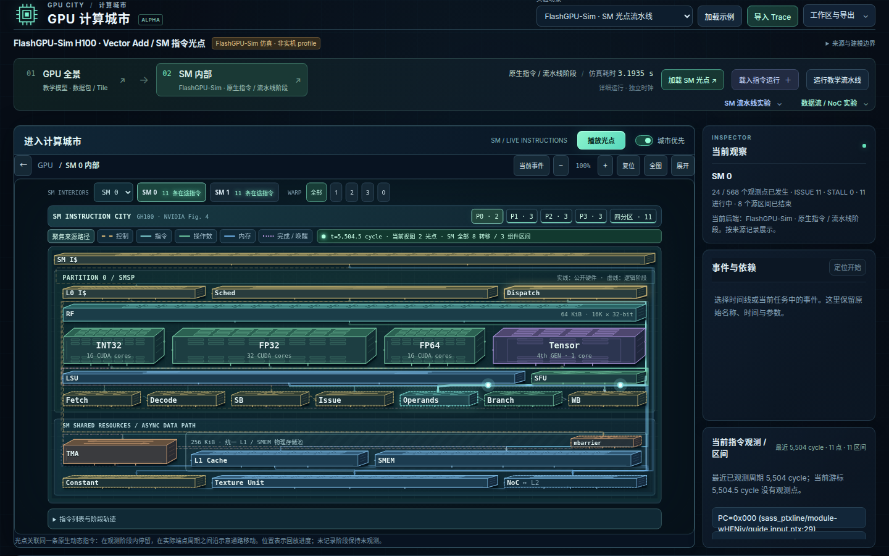

# SM 内部原生指令光点验证

日期：2026-10-15。将 FlashGPU-Sim 的动态指令生命周期接到组件沙盘，采用类似 [Gem5SimCity](https://github.com/Entropy-xcy/Gem5SimCity) 的“组件、指令 token、周期回放、点击检查”交互。本项目自行实现 SVG 盒子与光点，没有复制其渲染代码。

## 原生阶段与来源

固定 FlashGPU-Sim `291fbe172332eb481556632a79eb9cfc93cf46bf`，在干净源码上应用 [只读 observer 补丁](../tools/detailed/flashgpu-pipeline-observer.patch)，CUDA 12.8 / GCC 13.3 / 单 OpenMP 线程原生编译并执行 vectorAdd。补丁只输出生命周期记录，不修改流水线调度或时序状态；捕获后恢复源码。复现命令见 [adapter](../tools/detailed/README.md)。

| 实际捕获 | 结果 |
| --- | --- |
| 动态指令 | 176 条，全部记录原生 COMPLETE，全部有非零移动区间 |
| 观测范围 | 2 个有记录的 SM、8 个 warp，各 SM 的四个分区都有光点 |
| 原生阶段点 | 1,136；ISSUE / OPERAND_COLLECT / OPERAND_READY / EXECUTE / EXECUTE_END / WRITEBACK / COMPLETE 的实际记录 |
| 阶段移动区间 | 488，两个端点均为同 UID、同 SM 的原生时间点 |
| 组件驻留区间 | 190，保留实际收集 / 执行 / 等待区间 |
| 合计事件 | 1,814；原始观测窗口 5,502–5,906 cycles |
| 后端总周期 | 6,212，与未加 observer 的 baseline 一致；不截成指令窗口 |
| 功能检查 | 256/256 输出与 CPU 参考精确相符 |
| workload 进程墙钟 | 3.193459781 s；启动、PTX 提取、仿真、检查、日志输出在内，编译和转换在外 |

[原生日志](../examples/flashgpu-vectoradd-pipeline.log)、[trace](../examples/flashgpu-vectoradd-pipeline.json) 与 [manifest](../examples/flashgpu-vectoradd-pipeline.manifest.json) 保存原生 UID、PC/PTX、warp、active mask、scheduler、实际执行单元名称/索引、sub-core 配置、分区映射、hook 位置、源码补丁与产物 hash。

原生 ISSUE 插入 ID_OC 对应示意 Dispatch；collector 分配与 ready 对应 Operand Collector；执行单元位置由 native FU 名称和实际配置决定。共享 MEM 单元按发射分区放置以便检查，不声称有多个物理 LSU。全局 load 的 EXECUTE→WRITEBACK 区间包含内存等待；光点表示生命周期进展，不代表物理连线或逐存储事务的飞行时间。store 的 COMPLETE 是原生 LSU 退休，不代表全局可见。未观测的 writeback、取指/译码、cache/NoC 阶段不补造。

## 回放与交互

- 首次点击“SM 内部”或“加载 SM 光点”即打开原生沙盘；默认聚焦有来源的路径，可展开完整架构与指令列表。
- 参考 NVIDIA GH100 官方 Figure 4 调整功能层次：控制/逻辑阶段约22–28 px，RF是宽存储带，计算阵列约60–70 px，共享L1/SMEM构成统一底部存储区域；宽屏四分区横向并排。不同形状按视口剩余高度自动适配，尺寸不表示芯片物理面积。1366×768、1280×800、1440×900 的单分区/四分区、来源路径/完整架构共 12 种视图均检查：6 / 24 / 25 / 76 个组件完整进入画布，无画布内横向或纵向滚动。全名、细节和状态保留在悬停说明/规格弹窗；顶部可直接播放或暂停。
- 光点沿类型化连线推进，或在组件顶部表示驻留；光晕、拖尾与核心位置只由仿真周期计算。SVG 节点复用，每个视图最多绘制 96 个，并显示总数。
- SM 0 / SM 1、P0–P3 / 四分区可切换；点击光点显示 PC、warp、UID、原生执行单元与同一指令全部已记录阶段，点击阶段定位原始周期。
- Chrome 验证暂停位置稳定、不同周期位置改变、回退位置复现，以及弯折通路的光点点击；拖尾独立于光点的交互命中区域。正常动画自动播放，减少动画模式暂停。原生日志导入、宏观/详细独立时钟、工作区恢复与手机 390/320 px 均检查。
- 自动检查验证所有阶段端点、原始日志重新导入、patch/log/JSON hash、四分区移动、驻留、无假 writeback、无跨 SM UID、未知格式拒绝，以及原有教学 / point-only 格式兼容。

