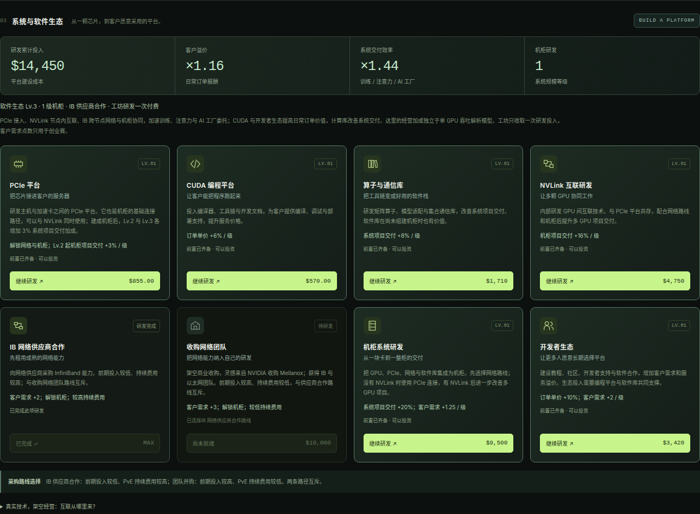
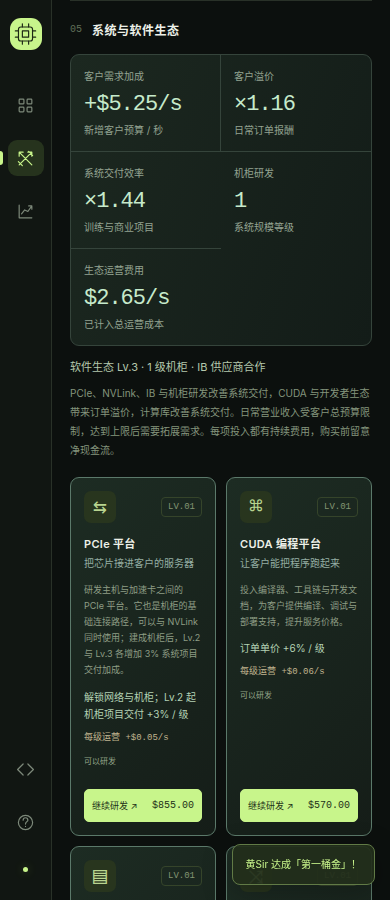

# 系统与软件生态验证

日期：2026-10-16。入口 `/web/game/` 与 `/web/game/pve/`。

## 规则与兼容性

- `npm test`：244 项通过。新增共享规则、订单溢价、大型应用交付、资本账本、对手策略与存档验证。
- 购买同时检查经营收入、现金、硬件、系统前置及互斥网络路线；支出不计入营业收入。
- 单颗 GPU 的吞吐、周期与缓存性能不受系统研发修改；客户溢价与项目交付分别应用一次。
- PCIe 二、三级仅在建成机柜后改善系统交付，NVLink 的项目收益也要求网络与机柜配合。
- 系统投入进入创业赛资产和持续费用；不同公司的相同硬件不会因缓存复用而共享业务状态。
- 旧存档默认零系统投入；损坏的等级、前置、收入与路线得到校验。离线推进与同等时长连续经营一致。
- 破产后禁止新研发；对手在后期依据利润与储备选择不同网络路线。
- `npm run validate`：七份既有轨迹全部通过；`npm run build`：三个页面与共享业务模块包含在静态构建内。

原有 `npm run benchmark:pve` 三条从零经营策略仍得到相同结果：主动均衡投资 569 秒由玩家获胜，完全挂机 1,334 秒由灰盒实验室获胜，计算过度扩张 821 秒破产。新投资是额外选择，不要求旧策略强制购买。

## 浏览器交互

本机 Google Chrome + Playwright，在 1440 px 桌面与 390 px 手机视口检查两个页面。界面验收使用满足研发条件的测试存档；这些存档不作为从零经营可行性的证据。

1. 新存档显示八项研发及对应锁定原因，客户溢价和系统交付倍率均为 1。
2. 依次通过页面购买 CUDA、PCIe、加速库、开发者生态、NVLink、IB 合作与机柜，所有等级正确写入存档。
3. 该组合显示订单单价 ×1.16、系统交付 ×1.44；创业赛新增客户预算 $5.25/秒、系统维护费用 $2.65/秒。
4. IB 合作后收购按钮锁定并说明已选择的路线。刷新页面保留所购等级、路线与收益。
5. 暂停创业赛关闭研发操作，继续后重新开放；排行榜显示三家公司的软件、机柜与网络路线。
6. 桌面、手机页面和研发卡片均无横向溢出，无 JavaScript 异常或失败资源请求。

价格、费用、收入、项目工作量和收益倍率仍是教学游戏参数；没有模拟真实链路拥塞、集合通信或机柜冷却。
