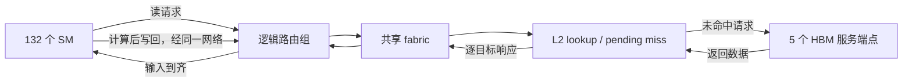

# H100 规模的数据流模型

本轮默认场景使用本仓库的 `GPU City Traffic Model`：一个可修改参数、生成完整运输事件的离散事件教学模型。它与 GTSim 和详细指令运行分别保存；不会将 GTSim 的计算区间展开成猜测的内存事务。

## 真实规格与抽象边界

默认采用 **H100 SXM：132 SM、5 个 HBM3 堆栈**。NVIDIA 同一资料还列出 8 GPC、66 TPC、80 GB HBM3 和 50 MB L2；本模型未重建其真实 GPC 布局、控制器、容量与内部互连。完整 GH100 的 144 SM 和 H100 PCIe 的 114 SM 不用于 SXM 预设。[NVIDIA Hopper Architecture In-Depth](https://developer.nvidia.com/blog/nvidia-hopper-architecture-in-depth/)

| 本轮实现 | 含义 |
| --- | --- |
| 132 个 SM | 全部作为执行端点，3 轮各一个 tile；每个 SM 都有输入、计算和写回 |
| 5 个 HBM 服务端点 | 与 SXM 堆栈数量一致；不展开其 10 个真实内存控制器、bank 或 DRAM 命令 |
| 12 个逻辑路由组 | 便于教学与绘制的分组，**不是 NVIDIA 的 8 个 GPC** |
| 8 个逻辑 L2 bank | 用于地址映射与服务竞争；不是实机 cache 分区数或 50 MB 容量仿真 |
| 路由器 / fabric | 理想中转节点，无额外内部交换仲裁；竞争发生在有向链路和端点资源 |
| 周期与带宽 | 可编辑模型参数，未校准为 H100 实测周期、NoC 带宽或 memory latency |

图中完整显示所有 SM，位置与盒子尺寸为显示布局。旧 GTSim 小 GEMM 仍只记录 2 个 SM 的操作，其余配置位置标为“未观测”，不会冒充空闲 SM。Chrome profile 保持原生轨道。

## 请求、共享数据分发与写回

每个 tile 固定归属一个 SM，有一个共享输入和一个私有输入。两个输入全部返回后才能计算，计算完成后写回到 HBM，再开始该 SM 的下一轮。逻辑 CTA ID 为 `round * numSms + smId`；这只是教学工作负载归属，没有执行 CUDA 指令或 GEMM 张量运算。



同轮共享 key 映射到相同 L2 bank。首次未命中发起 HBM 读取；数据未返回时的同 key 请求加入 pending miss，返回后的请求从共享 tile 缓存命中。L2 为每个目标 SM 生成独立响应包，经实际模型路由分发。它表现共享数据的一对多供给，但**不是 HBM 天然广播，也不是硬件 NoC multicast 树**。

关闭“共享请求合并”时，每个共享请求独立访问 HBM；交付给 SM 的总数据不变。L2 在本工作负载中只缓存共享 tile，无驱逐；私有输入首次读取，输出采用模型规定的直达 HBM 写回路径。未模拟 L1、shared memory、sector 合并、coherence、真实 CTA 调度或 TMA multicast。

## 时间与资源竞争

引擎以 `(time, insertionSequence)` 稳定事件顺序运行。请求在到达资源时加入 FCFS 队列；资源完成后才释放并服务下一项，后续 hop 不能早于前一跳完成。

- 每条有向链路独立，反向链路可并行；一次服务占用 `ceil(bytes / bytesPerCycle) + latencyCycles`。
- 采用整包 store-and-forward，每跳完整传输后进入下一跳，不模拟 wormhole、flit 或串行化与传播重叠。
- L2 lookup、HBM read/write、SM compute 也分别有单服务资源和因果依赖。
- 等待输出为明确的 `[arrival, serviceStart)` queue 区间，服务和传输区间另记。
- **等待队列无界**；已建模竞争与排队，尚无有限 buffer、credit/backpressure、丢包或死锁模型。

改带宽、共享策略会重新运行模型，生成新的事件与完成时间；修改回放速度只改变动画。屏幕中光包位置仅由当前 hop 的原始区间插值，暂停、定位、回退得到相同状态。

## 数据契约与扩展

`meta.capabilities` 声明 `tile_tasks`、`memory_requests`、`noc_transfers`，`trafficSchemaVersion: 1`。`meta.topology` 保存全部节点与有向链路，每个 ID 对应 canonical component；链路提供带宽、延迟与单服务容量。

每个 `transfer` 区间含 `args.linkId`、从 0 开始的 `hopIndex` 与 `flow`：

```json
{
  "packetId": "packet:17",
  "requestId": "read:0:7:shared",
  "sourceId": "fabric",
  "targetId": "router-0",
  "originId": "l2-2",
  "destinationId": "sm-7",
  "bytes": 4096,
  "kind": "read-response",
  "dataKey": "shared:0",
  "shared": true
}
```

`sourceId/targetId` 是当前跳端点，`originId/destinationId` 是整包端点。同包各跳保留 payload、request 和数据身份；请求、响应、HBM fetch、写回可以是不同 packet。`queue/service` 有自己的区间和资源，计算事件通过完成依赖引用两个输入响应。

[traffic-contract.js](../lib/traffic-contract.js) 额外验证拓扑、链路端点、包身份和字节数、路由连续性、到达时序、单服务链路不重叠及带宽下界。声明网络能力的导入不能绕过校验。显式 excerpt 可用 `trafficComplete: false` 保留已知端点；不补造缺失 hop。

后续真实后端若能输出同一契约，可以直接驱动渲染。真正的树形 multicast、flit、有限队列与 credit 需要扩展版本及对应验证，不能只增加动画路线。

## 可复现实验

```bash
node scripts/generate-traffic.mjs
npm test
npm run validate
```

| 同一 132 SM / 3 轮任务 | 默认 NoC 64 B/cycle | 慢 NoC 16 B/cycle |
| --- | ---: | ---: |
| 完成 tile | 396 | 396 |
| 事件区间 / 时间点 | 12,822 | 12,966 |
| 完成时间（模型周期） | 38,768 | 54,159 |
| 共享逻辑读取 | 396 | 396 |
| 共享 HBM 读取 | 3 | 3 |

默认共享读取节省 393 次，其中 80 次在 pending miss 合并、313 次返回后命中。它们是同一批请求的不同去向，不能重复相加到总请求数。`linkBytes` 统计每跳传输字节，不等于 HBM 读取字节或 SM 有效输入字节。

测试覆盖所有 SM 完成、请求/响应与字节守恒、合并分发、计算输入依赖、写回提交、FCFS、路由连续性、带宽实验、确定性及非法参数；运行结果验证模型实现，不代表实机性能复现。
